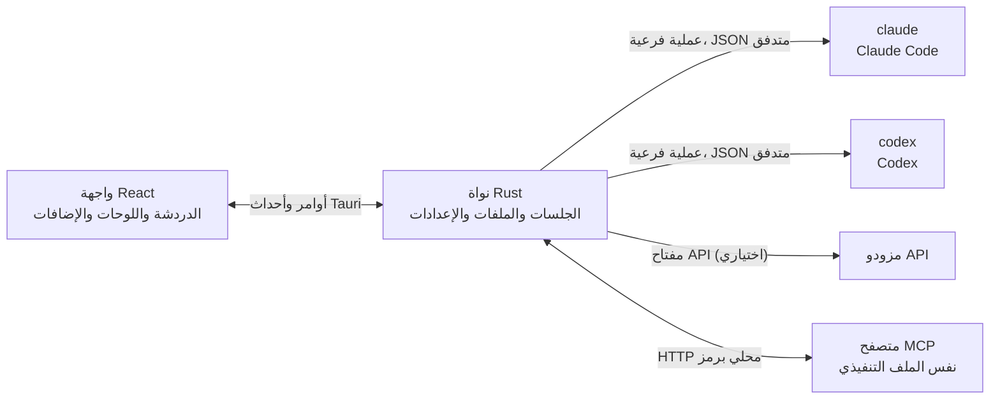

<div dir="rtl">

<p align="center">
  
</p>

<h1 align="center">LunaHarness</h1>

<p align="center">
  <a href="README.md">Português (Brasil)</a> · <a href="README.en.md">English</a> · <a href="README.es.md">Español</a> · <a href="README.fr.md">Français</a> · <a href="README.de.md">Deutsch</a> · <a href="README.it.md">Italiano</a> · <a href="README.nl.md">Nederlands</a> · <a href="README.pl.md">Polski</a> · <a href="README.sv.md">Svenska</a> · <a href="README.ru.md">Русский</a> · <a href="README.uk.md">Українська</a> · <a href="README.tr.md">Türkçe</a> · <strong>العربية</strong> · <a href="README.he.md">עברית</a> · <a href="README.hi.md">हिन्दी</a> · <a href="README.id.md">Bahasa Indonesia</a> · <a href="README.vi.md">Tiếng Việt</a> · <a href="README.th.md">ไทย</a> · <a href="README.ja.md">日本語</a> · <a href="README.ko.md">한국어</a> · <a href="README.zh-CN.md">简体中文</a> · <a href="README.zh-TW.md">繁體中文</a>
</p>

<p align="center">
  تطبيق سطح مكتب للتحدث مع <strong>Claude Code</strong> و<strong>Codex</strong> في نافذة واحدة، مع إضافات ومهارات وخوادم MCP ومتصفح يمكن للوكيل استخدامه.
</p>

---

## ما هو

LunaHarness ليس نموذج ذكاء اصطناعي. إنه **غلاف** حول واجهتي الأوامر الرسميتين اللتين تستخدمهما بالفعل: `claude` (Claude Code) و`codex` (Codex). يشغّل التطبيق هذه الأدوات، ويستخدم تسجيل الدخول الذي أجريته فيها، ويعرض المحادثة في نافذة دردشة، وبجانبها ما يفعله الوكيل: تغييرات الملفات والخطة والتقدّم وطرفية.

الهدف هو مكان واحد للعمل مع الوكيل دون فقدان ما تقدّمه الأدوات:

- تبديل المزود والنموذج ومستوى الجهد ووضع الأذونات دون إعادة تشغيل المحادثة.
- رؤية الفرق (diff) لتغييرات الوكيل، والتراجع عن التغييرات، والعودة إلى نقطة سابقة.
- تثبيت المهارات وخوادم MCP والإضافات مرة واحدة واستخدامها في الأداتين.
- منح الوكيل متصفحه الخاص لقراءة الصفحات والتفاعل معها.

## الميزات

**المحادثة**
- دردشة بالبث المباشر، مع مرفقات الصور والملفات، وقائمة `/` تضم أوامر لونا والمهارات وأوامر واجهات الأوامر.
- وضع التخطيط: تذهب الخطة الكاملة إلى لوحة **الخطة**، وتعرض فقاعة الدردشة ملخصًا فقط.
- ضغط السياق، يدويًا (`/compactar`) أو تلقائيًا قرب الحد.
- قواعد عامة: النص الذي تكتبه يذهب إلى `CLAUDE.md` و`AGENTS.md` في الأداتين.

**اللوحة الجانبية**
- **التغييرات:** قائمة بالملفات المعدّلة، مع الفرق والتراجع.
- **الخطة** و**التقدّم:** خطة الوكيل وخطوات المهمة بالترتيب.
- **الطرفية:** صدفة في مجلد المشروع (`Ctrl + `` `).
- **المتصفح:** صفحة مضمّنة يمكن للوكيل التحكم فيها أيضًا (انظر [الحالة الحالية](#الحالة-الحالية)).

**الامتدادات**
- **المهارات** و**خوادم MCP** من كتالوجات رسمية أو عبر عنوان URL، مثبتة في الإعدادات العامة للأداتين.
- **إضافات** تضيف سلوكًا إلى الدردشة: لوحات في الشريط الجانبي وأوامر وتنبيهات. إضافة افتراضية، **Cache de Tokens**، تعرض مقدار الجزء من الموجّه الذي أُعيد استخدامه من ذاكرة المزود المؤقتة.
- تبقى أسرار MCP في متغيرات البيئة لمستخدمك. لا يخزّن التطبيق القيمة ولا يعرضها أبدًا.

**المظهر**
- سمة فاتحة وأخرى داكنة، مع تأثير زجاجي اختياري.
- أصوات رد وتنبيهات اختيارية عندما لا تكون النافذة في الواجهة الأمامية.

## كيف يعمل



- لكل واجهة أوامر **مُهايئ** يترجم مخرجات JSON الخاصة بها إلى أحداث داخلية. لا تقرأ الواجهة الصيغة الخام أبدًا.
- لا يحتفظ التطبيق ببيانات اعتمادك لواجهات الأوامر: الملف التنفيذي الرسمي هو من يدير تسجيل الدخول.
- مفاتيح API اختيارية، لكل ملف تعريف، ومحفوظة في التخزين الآمن للنظام.

## التنزيل

- عند نشر إصدار، سيكون مثبّت Windows في [صفحة الإصدارات](https://github.com/GuilhermeFelix95/LunaHarnes/releases).
- المتطلبات: Windows 10 (الإصدار 1809 أو أحدث) أو Windows 11، وواجهة CLI واحدة على الأقل مثبتة ومسجّل فيها الدخول (`claude` أو `codex`). لا حاجة إلى Node.js أو Rust.
- المثبّت غير موقّع برمجياً بعد، لذلك قد يعرض Windows تحذير SmartScreen. اختر "المزيد من المعلومات" ثم "تشغيل على أي حال".

## المتطلبات

- **Windows 10 أو 11** (المشروع مُعدّ حاليًا لنظام Windows؛ وسكربتات البناء تستخدم MSVC).
- **Node.js** إصدار LTS و**npm**.
- **Rust** (سلسلة الأدوات `stable`، `x86_64-pc-windows-msvc`) وأدوات بناء C++ من Visual Studio.
- واجهة أوامر واحدة على الأقل مثبتة وقد سجّلت الدخول: Claude Code و/أو Codex.

## التثبيت والتشغيل

```bash
git clone https://github.com/GuilhermeFelix95/LunaHarnes.git
cd LunaHarnes
npm install
```

لفتح التطبيق في وضع التطوير:

```bash
npm run dev:app
```

لبناء الملف التنفيذي:

```bash
npm run build:app
```

لتشغيل الواجهة وحدها في المتصفح (دون نواة Rust، أي دون واجهات الأوامر):

```bash
npm run dev
```

## الاختبارات

```bash
npm test                 # الواجهة الأمامية (Vitest + Testing Library)
npm run test:rust        # نواة Rust (cargo test)
```

عند تعديل وحدة، شغّل اختباراتها؛ أما المجموعة الكاملة فتُشغَّل عند طلبها.

## البنية

```
src/                 واجهة React + TypeScript (الدردشة، اللوحات، الإضافات)
src-tauri/src/       نواة Rust (المزودون، الجلسات، الملفات، MCP، الإضافات، المتصفح)
src-tauri/marketplace/  الكتالوجات الرسمية المضمّنة (المهارات، MCP، الإضافات)، مع sha256
plugins-examples/    إضافات مرجعية
bin/                 الأمر `luna` (يثبّت المهارات وMCP والإضافات من الطرفية)
docs/                الأدلة: الحزمة التقنية، الإضافات، المهارات، MCP
spec/                مواصفات الميزات (ذاكرة الموجّه المؤقتة، ذاكرة الردود المؤقتة)
```

## التوثيق

- [`docs/stack.md`](docs/stack.md): الحزمة التقنية والبنية وقواعد المشروع والتغييرات.
- [`docs/plugins.md`](docs/plugins.md): كيفية إنشاء الإضافات (تقرؤه لونا نفسها أيضًا).
- [`docs/skills.md`](docs/skills.md): كيف تعمل المهارات.
- [`docs/mcp.md`](docs/mcp.md): خوادم MCP وكيفية التعامل مع الأسرار.
- [`docs/motor-proprio.md`](docs/motor-proprio.md): دراسة عن محرك خاص وقواعد استخدام الاشتراكات.
- [`spec/cache-de-prompt.md`](spec/cache-de-prompt.md): كيف يقيس التطبيق ذاكرة المزود المؤقتة.

<a id="الحالة-الحالية"></a>
## الحالة الحالية

يعمل ومُختبَر:

- المحادثة مع Claude Code وCodex، والتخطيط، والتقدّم، والضغط، والفرق.
- المهارات وخوادم MCP والإضافات المثبتة من التطبيق أو بالأمر `luna`.
- ذاكرة الموجّه المؤقتة مقاسة لكل دورة، مع إضافة Cache de Tokens.
- طرفية مدمجة وworktrees لكل فرع.

قيد التطوير، ولم يُتحقَّق منه بعد من البداية إلى النهاية داخل التطبيق:

- **المتصفح المدمج:** تظهر الصفحة في webview داخل النافذة، ويحصل Claude على أدوات التنقل والقراءة والنقر والكتابة. يستخدم ميزة `unstable` في Tauri. ولا يحصل Codex على هذه الأدوات بعد.

## المساهمة

تشرح الأدلة في `docs/` معايير المشروع. تأتي تغييرات السلوك مع اختبارات، ويتم تحديث `docs/stack.md` و`MEMORY.md` مع الشيفرة.

</div>
