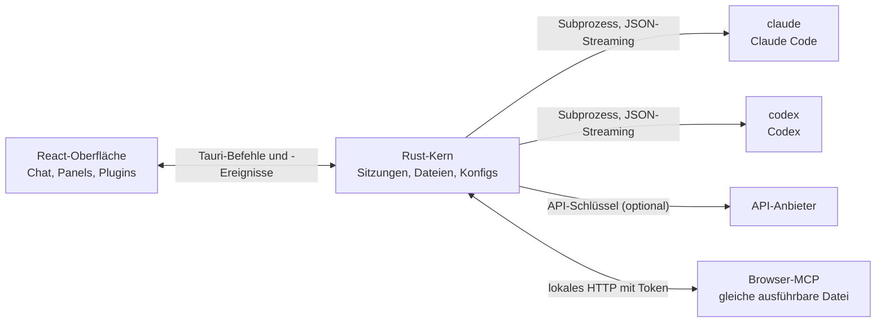

<p align="center">
  
</p>

<h1 align="center">LunaHarness</h1>

<p align="center">
  <a href="README.md">Português (Brasil)</a> · <a href="README.en.md">English</a> · <a href="README.es.md">Español</a> · <a href="README.fr.md">Français</a> · <strong>Deutsch</strong> · <a href="README.it.md">Italiano</a> · <a href="README.nl.md">Nederlands</a> · <a href="README.pl.md">Polski</a> · <a href="README.sv.md">Svenska</a> · <a href="README.ru.md">Русский</a> · <a href="README.uk.md">Українська</a> · <a href="README.tr.md">Türkçe</a> · <a href="README.ar.md">العربية</a> · <a href="README.he.md">עברית</a> · <a href="README.hi.md">हिन्दी</a> · <a href="README.id.md">Bahasa Indonesia</a> · <a href="README.vi.md">Tiếng Việt</a> · <a href="README.th.md">ไทย</a> · <a href="README.ja.md">日本語</a> · <a href="README.ko.md">한국어</a> · <a href="README.zh-CN.md">简体中文</a> · <a href="README.zh-TW.md">繁體中文</a>
</p>

<p align="center">
  Eine Desktop-App, um mit <strong>Claude Code</strong> und <strong>Codex</strong> in einem Fenster zu arbeiten, mit Plugins, Skills, MCP-Servern und einem Browser, den der Agent nutzen kann.
</p>

---

## Was ist das

LunaHarness ist kein KI-Modell. Es ist eine **Hülle** um die offiziellen CLIs, die Sie bereits verwenden: `claude` (Claude Code) und `codex` (Codex). Die App startet diese Werkzeuge, nutzt die Anmeldung, die Sie dort schon gemacht haben, und zeigt die Unterhaltung in einem Chatfenster, daneben, was der Agent tut: Dateiänderungen, Plan, Fortschritt und ein Terminal.

Das Ziel ist ein einziger Ort für die Arbeit mit dem Agenten, ohne die Möglichkeiten der CLIs zu verlieren:

- Anbieter, Modell, Aufwand und Berechtigungsmodus wechseln, ohne die Unterhaltung neu zu starten.
- Den Diff der Änderungen des Agenten sehen, Änderungen rückgängig machen und zu einem früheren Stand zurückkehren.
- Skills, MCP-Server und Plugins einmal installieren und in beiden CLIs nutzen.
- Dem Agenten einen eigenen Browser geben, um Seiten zu lesen und mit ihnen zu interagieren.

## Funktionen

**Unterhaltung**
- Chat mit Streaming, Bild- und Dateianhängen und einem `/`-Menü mit Luna-Befehlen, Skills und CLI-Befehlen.
- Planungsmodus: Der vollständige Plan erscheint im Bereich **Plan**, die Chatblase zeigt nur eine Zusammenfassung.
- Kontextkomprimierung, manuell (`/compactar`) oder automatisch nahe am Limit.
- Globale Regeln: Der Text, den Sie schreiben, landet in der `CLAUDE.md` und der `AGENTS.md` beider CLIs.

**Seitenleiste**
- **Änderungen:** Liste der geänderten Dateien, mit Diff und Rückgängig.
- **Plan** und **Fortschritt:** der Plan des Agenten und die Aufgabenschritte, in Reihenfolge.
- **Terminal:** eine Shell im Projektordner (`Strg + `` `).
- **Browser:** eine eingebettete Seite, die der Agent ebenfalls steuern kann (siehe [Aktueller Stand](#aktueller-stand)).

**Erweiterungen**
- **Skills** und **MCP-Server** aus offiziellen Katalogen oder per URL, installiert in der globalen Konfiguration beider CLIs.
- **Plugins**, die dem Chat Verhalten hinzufügen: Panels in der Seitenleiste, Befehle und Hinweise. Ein Standard-Plugin, **Cache de Tokens**, zeigt, wie viel des Prompts aus dem Cache des Anbieters wiederverwendet wurde.
- MCP-Geheimnisse bleiben in den Umgebungsvariablen Ihres Benutzers. Die App speichert oder zeigt den Wert nie.

**Aussehen**
- Helles und dunkles Design, mit optionalem Glaseffekt.
- Optionale Antwortgeräusche und Hinweise, wenn das Fenster nicht im Fokus ist.

## So funktioniert es



- Jede CLI hat einen **Adapter**, der ihre JSON-Ausgabe in interne Ereignisse übersetzt. Das Frontend liest nie das Rohformat.
- Die App speichert Ihre CLI-Zugangsdaten nicht: Die offizielle Anwendung übernimmt die Anmeldung.
- API-Schlüssel sind optional, pro Profil, und werden im sicheren Speicher des Systems abgelegt.

## Herunterladen

- Sobald eine Version veröffentlicht ist, liegt der Windows-Installer auf der [Releases-Seite](https://github.com/GuilhermeFelix95/LunaHarnes/releases).
- Voraussetzungen: Windows 10 (Version 1809 oder neuer) oder Windows 11 und mindestens ein installiertes und angemeldetes CLI (`claude` oder `codex`). Node.js und Rust werden nicht benötigt.
- Der Installer ist noch nicht code-signiert, Windows kann daher eine SmartScreen-Warnung zeigen. Wähle „Weitere Informationen“ und dann „Trotzdem ausführen“.

## Voraussetzungen

- **Windows 10 oder 11** (das Projekt ist derzeit für Windows vorbereitet; die Build-Skripte verwenden MSVC).
- **Node.js** LTS und **npm**.
- **Rust** (`stable`-Toolchain, `x86_64-pc-windows-msvc`) und die C++-Buildwerkzeuge von Visual Studio.
- Mindestens eine installierte und angemeldete CLI: Claude Code und/oder Codex.

## Installation und Start

```bash
git clone https://github.com/GuilhermeFelix95/LunaHarnes.git
cd LunaHarnes
npm install
```

Um die App im Entwicklungsmodus zu öffnen:

```bash
npm run dev:app
```

Um die ausführbare Datei zu erstellen:

```bash
npm run build:app
```

Um nur die Oberfläche im Browser zu starten (ohne Rust-Kern, also ohne CLIs):

```bash
npm run dev
```

## Tests

```bash
npm test                 # Frontend (Vitest + Testing Library)
npm run test:rust        # Rust-Kern (cargo test)
```

Wenn Sie ein Modul ändern, führen Sie dessen Tests aus; die vollständige Suite ist für den Fall gedacht, dass Sie sie anfordern.

## Struktur

```
src/                 React- + TypeScript-Oberfläche (Chat, Panels, Plugins)
src-tauri/src/       Rust-Kern (Anbieter, Sitzungen, Dateien, MCP, Plugins, Browser)
src-tauri/marketplace/  eingebaute offizielle Kataloge (Skills, MCP, Plugins), mit sha256
plugins-examples/    Referenz-Plugins
bin/                 Befehl `luna` (installiert Skills, MCP und Plugins im Terminal)
docs/                Leitfäden: Stack, Plugins, Skills, MCP
spec/                Funktionsspezifikationen (Prompt-Cache, Antwort-Cache)
```

## Dokumentation

- [`docs/stack.md`](docs/stack.md): Stack, Architektur, Projektregeln und Änderungen.
- [`docs/plugins.md`](docs/plugins.md): so erstellen Sie Plugins (auch Luna selbst liest sie).
- [`docs/skills.md`](docs/skills.md): wie Skills funktionieren.
- [`docs/mcp.md`](docs/mcp.md): MCP-Server und der Umgang mit Geheimnissen.
- [`docs/motor-proprio.md`](docs/motor-proprio.md): Studie zu einer eigenen Engine und den Regeln für die Nutzung von Abos.
- [`spec/cache-de-prompt.md`](spec/cache-de-prompt.md): wie die App den Cache des Anbieters misst.

## Aktueller Stand

Funktioniert und getestet:

- Unterhaltung mit Claude Code und Codex, Planung, Fortschritt, Komprimierung und Diff.
- Skills, MCP-Server und Plugins, installiert über die App oder den Befehl `luna`.
- Prompt-Cache pro Durchlauf gemessen, mit dem Plugin Cache de Tokens.
- Integriertes Terminal und Worktrees pro Branch.

In Entwicklung, noch nicht durchgehend in der App geprüft:

- **Integrierter Browser:** Die Seite erscheint in einer Webview im Fenster, und Claude erhält die Werkzeuge navigieren, lesen, klicken und tippen. Er nutzt eine `unstable`-Funktion von Tauri. Codex erhält diese Werkzeuge noch nicht.

## Mitwirken

Die Leitfäden in `docs/` erklären die Standards des Projekts. Verhaltensänderungen kommen mit Tests, und `docs/stack.md` und `MEMORY.md` werden zusammen mit dem Code aktualisiert.
