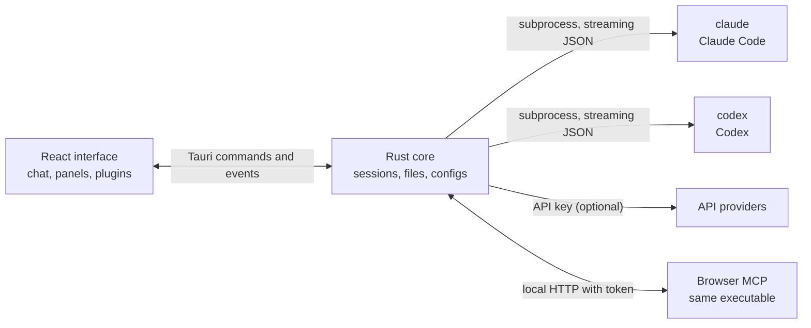

<p align="center">
  
</p>

<h1 align="center">LunaHarness</h1>

<p align="center">
  <a href="README.md">Português (Brasil)</a> · <strong>English</strong> · <a href="README.es.md">Español</a> · <a href="README.fr.md">Français</a> · <a href="README.de.md">Deutsch</a> · <a href="README.it.md">Italiano</a> · <a href="README.nl.md">Nederlands</a> · <a href="README.pl.md">Polski</a> · <a href="README.sv.md">Svenska</a> · <a href="README.ru.md">Русский</a> · <a href="README.uk.md">Українська</a> · <a href="README.tr.md">Türkçe</a> · <a href="README.ar.md">العربية</a> · <a href="README.he.md">עברית</a> · <a href="README.hi.md">हिन्दी</a> · <a href="README.id.md">Bahasa Indonesia</a> · <a href="README.vi.md">Tiếng Việt</a> · <a href="README.th.md">ไทย</a> · <a href="README.ja.md">日本語</a> · <a href="README.ko.md">한국어</a> · <a href="README.zh-CN.md">简体中文</a> · <a href="README.zh-TW.md">繁體中文</a>
</p>

<p align="center">
  A desktop app to talk to <strong>Claude Code</strong> and <strong>Codex</strong> in one window, with plugins, skills, MCP servers and a browser the agent can use.
</p>

---

## What it is

LunaHarness is not an AI model. It is a **shell** around the official CLIs you already use: `claude` (Claude Code) and `codex` (Codex). The app starts those tools, uses the login you already made in them, and shows the conversation in a chat window, with what the agent does next to it: file changes, plan, progress and a terminal.

The goal is one place to work with the agent, without losing what the CLIs offer:

- Switch provider, model, effort and permission mode without restarting the conversation.
- See the diff of what the agent changed, undo changes and go back to an earlier point.
- Install skills, MCP servers and plugins once and use them in both CLIs.
- Give the agent its own browser to read and interact with pages.

## Features

**Conversation**
- Chat with streaming, image and file attachments, and a `/` menu with Luna commands, skills and CLI commands.
- Planning mode: the full plan goes to the **Plan** panel, and the chat bubble shows only a summary.
- Context compaction, manually (`/compactar`) or automatically near the limit.
- Global rules: text you write goes into the `CLAUDE.md` and `AGENTS.md` of both CLIs.

**Side panel**
- **Changes:** list of changed files, with diff and undo.
- **Plan** and **Progress:** the agent's plan and the task steps, in order.
- **Terminal:** a shell in the project folder (`Ctrl + `` `).
- **Browser:** an embedded page that the agent can also control (see [Current status](#current-status)).

**Extensions**
- **Skills** and **MCP servers** from official catalogs or by URL, installed in the global settings of both CLIs.
- **Plugins** that add behavior to the chat: sidebar panels, commands and notices. A default plugin, **Cache de Tokens**, shows how much of the prompt was reused from the provider's cache.
- MCP secrets stay in your user environment variables. The app never stores or shows the value.

**Look and feel**
- Light and dark themes, with an optional glass effect.
- Optional response sounds and alerts when the window is not focused.

## How it works



- Each CLI has an **adapter** that translates its JSON output into internal events. The frontend never reads the raw format.
- The app does not keep your CLI credentials: the official binary handles the login.
- API keys are optional, per profile, and stored in the system's secure storage.

## Download

- When a version is published, the Windows installer is on the [releases page](https://github.com/GuilhermeFelix95/LunaHarnes/releases).
- Requirements: Windows 10 (version 1809 or later) or Windows 11, and at least one CLI installed and logged in (`claude` or `codex`). Node.js and Rust are not needed.
- The installer is not code-signed yet, so Windows may show a SmartScreen warning. Choose "More info" and then "Run anyway".

## Requirements

- **Windows 10 or 11** (the project is currently prepared for Windows; build scripts use MSVC).
- **Node.js** LTS and **npm**.
- **Rust** (`stable` toolchain, `x86_64-pc-windows-msvc`) and the Visual Studio C++ build tools.
- At least one CLI installed and logged in: Claude Code and/or Codex.

## Install and run

```bash
git clone https://github.com/GuilhermeFelix95/LunaHarnes.git
cd LunaHarnes
npm install
```

To open the app in development mode:

```bash
npm run dev:app
```

To build the executable:

```bash
npm run build:app
```

To run only the interface in the browser (no Rust core, so no CLIs):

```bash
npm run dev
```

## Tests

```bash
npm test                 # frontend (Vitest + Testing Library)
npm run test:rust        # Rust core (cargo test)
```

When you change a module, run that module's tests; the full suite is for when you ask for it.

## Structure

```
src/                 React + TypeScript interface (chat, panels, plugins)
src-tauri/src/       Rust core (providers, sessions, files, MCP, plugins, browser)
src-tauri/marketplace/  built-in official catalogs (skills, MCP, plugins), with sha256
plugins-examples/    reference plugins
bin/                 `luna` command (installs skills, MCP and plugins from the terminal)
docs/                guides: stack, plugins, skills, MCP
spec/                feature specs (prompt cache, response cache)
```

## Documentation

- [`docs/stack.md`](docs/stack.md): stack, architecture, project rules and changes.
- [`docs/plugins.md`](docs/plugins.md): how to create plugins (also read by Luna itself).
- [`docs/skills.md`](docs/skills.md): how skills work.
- [`docs/mcp.md`](docs/mcp.md): MCP servers and how secrets are handled.
- [`docs/motor-proprio.md`](docs/motor-proprio.md): study on an own engine and subscription usage rules.
- [`spec/cache-de-prompt.md`](spec/cache-de-prompt.md): how the app measures provider cache.

## Current status

Working and tested:

- Conversation with Claude Code and Codex, planning, progress, compaction and diff.
- Skills, MCP servers and plugins installed from the app or the `luna` command.
- Prompt cache measured per turn, with the Cache de Tokens plugin.
- Integrated terminal and branch worktrees.

In development, not yet verified end to end in the app:

- **Integrated browser:** the page appears in a webview inside the window, and Claude receives the navigate, read, click and type tools. It uses an `unstable` Tauri feature. Codex does not receive these tools yet.

## Contributing

The guides in `docs/` explain the project's standards. Behavior changes come with tests, and `docs/stack.md` and `MEMORY.md` are updated together with the code.
