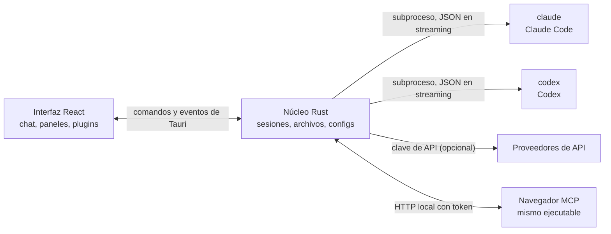

<p align="center">
  
</p>

<h1 align="center">LunaHarness</h1>

<p align="center">
  <a href="README.md">Português (Brasil)</a> · <a href="README.en.md">English</a> · <strong>Español</strong> · <a href="README.fr.md">Français</a> · <a href="README.de.md">Deutsch</a> · <a href="README.it.md">Italiano</a> · <a href="README.nl.md">Nederlands</a> · <a href="README.pl.md">Polski</a> · <a href="README.sv.md">Svenska</a> · <a href="README.ru.md">Русский</a> · <a href="README.uk.md">Українська</a> · <a href="README.tr.md">Türkçe</a> · <a href="README.ar.md">العربية</a> · <a href="README.he.md">עברית</a> · <a href="README.hi.md">हिन्दी</a> · <a href="README.id.md">Bahasa Indonesia</a> · <a href="README.vi.md">Tiếng Việt</a> · <a href="README.th.md">ไทย</a> · <a href="README.ja.md">日本語</a> · <a href="README.ko.md">한국어</a> · <a href="README.zh-CN.md">简体中文</a> · <a href="README.zh-TW.md">繁體中文</a>
</p>

<p align="center">
  Una aplicación de escritorio para hablar con <strong>Claude Code</strong> y <strong>Codex</strong> en una sola ventana, con plugins, skills, servidores MCP y un navegador que el agente puede usar.
</p>

---

## Qué es

LunaHarness no es un modelo de IA. Es una **capa** sobre las CLI oficiales que ya usas: `claude` (Claude Code) y `codex` (Codex). La aplicación inicia esas herramientas, usa el inicio de sesión que ya hiciste en ellas y muestra la conversación en una ventana de chat, con lo que hace el agente al lado: cambios de archivos, plan, progreso y una terminal.

El objetivo es tener un solo lugar para trabajar con el agente, sin perder lo que ofrecen las CLI:

- Cambiar de proveedor, modelo, esfuerzo y modo de permisos sin reiniciar la conversación.
- Ver el diff de lo que cambió el agente, deshacer cambios y volver a un punto anterior.
- Instalar skills, servidores MCP y plugins una vez y usarlos en ambas CLI.
- Darle al agente su propio navegador para leer e interactuar con páginas.

## Funciones

**Conversación**
- Chat con streaming, adjuntos de imagen y de archivo, y un menú `/` con comandos de Luna, skills y comandos de las CLI.
- Modo de planificación: el plan completo va al panel **Plan** y la burbuja del chat muestra solo un resumen.
- Compactación de contexto, manual (`/compactar`) o automática cerca del límite.
- Reglas globales: el texto que escribes va al `CLAUDE.md` y al `AGENTS.md` de ambas CLI.

**Panel lateral**
- **Cambios:** lista de archivos modificados, con diff y deshacer.
- **Plan** y **Progreso:** el plan del agente y los pasos de la tarea, en orden.
- **Terminal:** un shell en la carpeta del proyecto (`Ctrl + `` `).
- **Navegador:** una página embebida que el agente también puede controlar (ver [Estado actual](#estado-actual)).

**Extensiones**
- **Skills** y **servidores MCP** de catálogos oficiales o por URL, instalados en la configuración global de ambas CLI.
- **Plugins** que añaden comportamiento al chat: paneles en la barra lateral, comandos y avisos. Un plugin predeterminado, **Cache de Tokens**, muestra cuánto del prompt se reutilizó de la caché del proveedor.
- Los secretos de MCP quedan en las variables de entorno de tu usuario. La aplicación nunca guarda ni muestra el valor.

**Aspecto**
- Temas claro y oscuro, con efecto de cristal opcional.
- Sonidos de respuesta opcionales y avisos cuando la ventana no está en primer plano.

## Cómo funciona



- Cada CLI tiene un **adaptador** que traduce su salida JSON a eventos internos. El frontend nunca lee el formato bruto.
- La aplicación no guarda tus credenciales de las CLI: el binario oficial se encarga del inicio de sesión.
- Las claves de API son opcionales, por perfil, y se guardan en el almacenamiento seguro del sistema.

## Descargar

- Cuando haya una versión publicada, el instalador para Windows está en la [página de releases](https://github.com/GuilhermeFelix95/LunaHarnes/releases).
- Requisitos: Windows 10 (versión 1809 o posterior) o Windows 11, y al menos un CLI instalado y con sesión iniciada (`claude` o `codex`). No hace falta Node.js ni Rust.
- El instalador todavía no tiene firma de código, así que Windows puede mostrar un aviso de SmartScreen. Elige "Más información" y luego "Ejecutar de todas formas".

## Requisitos

- **Windows 10 u 11** (el proyecto está preparado hoy para Windows; los scripts de compilación usan MSVC).
- **Node.js** LTS y **npm**.
- **Rust** (toolchain `stable`, `x86_64-pc-windows-msvc`) y las herramientas de compilación de C++ de Visual Studio.
- Al menos una CLI instalada e iniciada: Claude Code y/o Codex.

## Instalación y ejecución

```bash
git clone https://github.com/GuilhermeFelix95/LunaHarnes.git
cd LunaHarnes
npm install
```

Para abrir la aplicación en modo de desarrollo:

```bash
npm run dev:app
```

Para generar el ejecutable:

```bash
npm run build:app
```

Para ejecutar solo la interfaz en el navegador (sin el núcleo Rust, así que sin CLI):

```bash
npm run dev
```

## Pruebas

```bash
npm test                 # frontend (Vitest + Testing Library)
npm run test:rust        # núcleo Rust (cargo test)
```

Al cambiar un módulo, ejecuta sus pruebas; la suite completa queda para cuando la pidas.

## Estructura

```
src/                 interfaz React + TypeScript (chat, paneles, plugins)
src-tauri/src/       núcleo Rust (proveedores, sesiones, archivos, MCP, plugins, navegador)
src-tauri/marketplace/  catálogos oficiales incluidos (skills, MCP, plugins), con sha256
plugins-examples/    plugins de referencia
bin/                 comando `luna` (instala skills, MCP y plugins desde la terminal)
docs/                guías: stack, plugins, skills, MCP
spec/                especificaciones de funciones (caché de prompt, caché de respuestas)
```

## Documentación

- [`docs/stack.md`](docs/stack.md): stack, arquitectura, reglas del proyecto y cambios.
- [`docs/plugins.md`](docs/plugins.md): cómo crear plugins (también lo lee la propia Luna).
- [`docs/skills.md`](docs/skills.md): cómo funcionan las skills.
- [`docs/mcp.md`](docs/mcp.md): servidores MCP y cómo se tratan los secretos.
- [`docs/motor-proprio.md`](docs/motor-proprio.md): estudio sobre un motor propio y las reglas de uso de suscripciones.
- [`spec/cache-de-prompt.md`](spec/cache-de-prompt.md): cómo la aplicación mide la caché del proveedor.

## Estado actual

Funcionando y probado:

- Conversación con Claude Code y Codex, planificación, progreso, compactación y diff.
- Skills, servidores MCP y plugins instalados desde la aplicación o el comando `luna`.
- Caché de prompt medida por turno, con el plugin Cache de Tokens.
- Terminal integrada y worktrees por rama.

En desarrollo, todavía sin verificar de extremo a extremo en la aplicación:

- **Navegador integrado:** la página aparece en un webview dentro de la ventana, y Claude recibe las herramientas de navegar, leer, hacer clic y escribir. Usa una función `unstable` de Tauri. Codex todavía no recibe estas herramientas.

## Contribuir

Las guías en `docs/` explican el estándar del proyecto. Los cambios de comportamiento llevan pruebas, y `docs/stack.md` y `MEMORY.md` se actualizan junto con el código.
