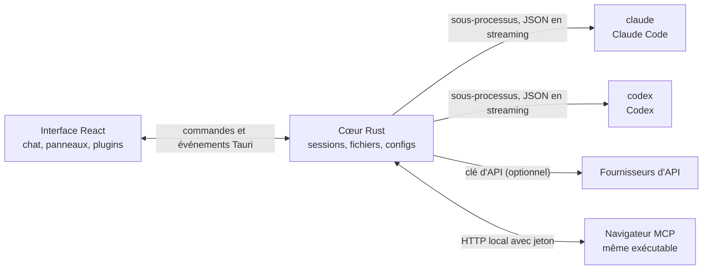

<p align="center">
  
</p>

<h1 align="center">LunaHarness</h1>

<p align="center">
  <a href="README.md">Português (Brasil)</a> · <a href="README.en.md">English</a> · <a href="README.es.md">Español</a> · <strong>Français</strong> · <a href="README.de.md">Deutsch</a> · <a href="README.it.md">Italiano</a> · <a href="README.nl.md">Nederlands</a> · <a href="README.pl.md">Polski</a> · <a href="README.sv.md">Svenska</a> · <a href="README.ru.md">Русский</a> · <a href="README.uk.md">Українська</a> · <a href="README.tr.md">Türkçe</a> · <a href="README.ar.md">العربية</a> · <a href="README.he.md">עברית</a> · <a href="README.hi.md">हिन्दी</a> · <a href="README.id.md">Bahasa Indonesia</a> · <a href="README.vi.md">Tiếng Việt</a> · <a href="README.th.md">ไทย</a> · <a href="README.ja.md">日本語</a> · <a href="README.ko.md">한국어</a> · <a href="README.zh-CN.md">简体中文</a> · <a href="README.zh-TW.md">繁體中文</a>
</p>

<p align="center">
  Une application de bureau pour discuter avec <strong>Claude Code</strong> et <strong>Codex</strong> dans une seule fenêtre, avec des plugins, des skills, des serveurs MCP et un navigateur que l'agent peut utiliser.
</p>

---

## Qu'est-ce que c'est

LunaHarness n'est pas un modèle d'IA. C'est une **coque** autour des CLI officielles que vous utilisez déjà : `claude` (Claude Code) et `codex` (Codex). L'application lance ces outils, utilise la connexion que vous avez déjà faite dans chacun, et affiche la conversation dans une fenêtre de chat, avec ce que fait l'agent à côté : modifications de fichiers, plan, progression et un terminal.

L'objectif est d'avoir un seul endroit pour travailler avec l'agent, sans perdre ce que proposent les CLI :

- Changer de fournisseur, de modèle, d'effort et de mode de permission sans relancer la conversation.
- Voir le diff de ce que l'agent a modifié, annuler des changements et revenir à un point antérieur.
- Installer des skills, des serveurs MCP et des plugins une fois et les utiliser dans les deux CLI.
- Donner à l'agent son propre navigateur pour lire et interagir avec des pages.

## Fonctionnalités

**Conversation**
- Chat en streaming, pièces jointes (images et fichiers) et menu `/` avec les commandes de Luna, les skills et les commandes des CLI.
- Mode planification : le plan complet va dans le panneau **Plan**, et la bulle du chat n'affiche qu'un résumé.
- Compactage du contexte, manuel (`/compactar`) ou automatique près de la limite.
- Règles globales : le texte que vous écrivez va dans le `CLAUDE.md` et l'`AGENTS.md` des deux CLI.

**Panneau latéral**
- **Modifications :** liste des fichiers modifiés, avec diff et annulation.
- **Plan** et **Progression :** le plan de l'agent et les étapes de la tâche, dans l'ordre.
- **Terminal :** un shell dans le dossier du projet (`Ctrl + `` `).
- **Navigateur :** une page intégrée que l'agent peut aussi contrôler (voir [État actuel](#état-actuel)).

**Extensions**
- **Skills** et **serveurs MCP** issus de catalogues officiels ou d'une URL, installés dans la configuration globale des deux CLI.
- **Plugins** qui ajoutent des comportements au chat : panneaux dans la barre latérale, commandes et avis. Un plugin par défaut, **Cache de Tokens**, montre combien du prompt a été réutilisé depuis le cache du fournisseur.
- Les secrets MCP restent dans les variables d'environnement de votre utilisateur. L'application ne stocke ni n'affiche jamais la valeur.

**Apparence**
- Thèmes clair et sombre, avec un effet verre optionnel.
- Sons de réponse optionnels et alertes lorsque la fenêtre n'a pas le focus.

## Fonctionnement



- Chaque CLI a un **adaptateur** qui traduit sa sortie JSON en événements internes. Le frontend ne lit jamais le format brut.
- L'application ne garde pas vos identifiants des CLI : c'est le binaire officiel qui gère la connexion.
- Les clés d'API sont facultatives, par profil, et stockées dans le stockage sécurisé du système.

## Télécharger

- Lorsqu'une version sera publiée, l'installateur Windows se trouve sur la [page des releases](https://github.com/GuilhermeFelix95/lunaCode/releases).
- Prérequis : Windows 10 (version 1809 ou ultérieure) ou Windows 11, et au moins un CLI installé et connecté (`claude` ou `codex`). Node.js et Rust ne sont pas nécessaires.
- L'installateur n'est pas encore signé, Windows peut donc afficher un avertissement SmartScreen. Choisissez « Informations complémentaires » puis « Exécuter quand même ».

## Prérequis

- **Windows 10 ou 11** (le projet est actuellement prévu pour Windows ; les scripts de build utilisent MSVC).
- **Node.js** LTS et **npm**.
- **Rust** (toolchain `stable`, `x86_64-pc-windows-msvc`) et les outils de build C++ de Visual Studio.
- Au moins une CLI installée et connectée : Claude Code et/ou Codex.

## Installation et exécution

```bash
git clone https://github.com/GuilhermeFelix95/lunaCode.git
cd LunaHarnes
npm install
```

Pour ouvrir l'application en mode développement :

```bash
npm run dev:app
```

Pour générer l'exécutable :

```bash
npm run build:app
```

Pour lancer seulement l'interface dans le navigateur (sans le cœur Rust, donc sans CLI) :

```bash
npm run dev
```

## Tests

```bash
npm test                 # frontend (Vitest + Testing Library)
npm run test:rust        # cœur Rust (cargo test)
```

Quand vous modifiez un module, lancez ses tests ; la suite complète sert quand vous la demandez.

## Structure

```
src/                 interface React + TypeScript (chat, panneaux, plugins)
src-tauri/src/       cœur Rust (fournisseurs, sessions, fichiers, MCP, plugins, navigateur)
src-tauri/marketplace/  catalogues officiels intégrés (skills, MCP, plugins), avec sha256
plugins-examples/    plugins de référence
bin/                 commande `luna` (installe skills, MCP et plugins depuis le terminal)
docs/                guides : stack, plugins, skills, MCP
spec/                spécifications des fonctions (cache de prompt, cache de réponses)
```

## Documentation

- [`docs/stack.md`](docs/stack.md) : stack, architecture, règles du projet et changements.
- [`docs/plugins.md`](docs/plugins.md) : comment créer des plugins (lu aussi par Luna elle-même).
- [`docs/skills.md`](docs/skills.md) : fonctionnement des skills.
- [`docs/mcp.md`](docs/mcp.md) : serveurs MCP et gestion des secrets.
- [`docs/motor-proprio.md`](docs/motor-proprio.md) : étude sur un moteur propre et règles d'usage des abonnements.
- [`spec/cache-de-prompt.md`](spec/cache-de-prompt.md) : comment l'application mesure le cache du fournisseur.

## État actuel

Fonctionnel et testé :

- Conversation avec Claude Code et Codex, planification, progression, compactage et diff.
- Skills, serveurs MCP et plugins installés depuis l'application ou la commande `luna`.
- Cache de prompt mesuré par tour, avec le plugin Cache de Tokens.
- Terminal intégré et worktrees par branche.

En développement, pas encore vérifié de bout en bout dans l'application :

- **Navigateur intégré :** la page apparaît dans une webview à l'intérieur de la fenêtre, et Claude reçoit les outils naviguer, lire, cliquer et saisir. Il utilise une fonction `unstable` de Tauri. Codex ne reçoit pas encore ces outils.

## Contribuer

Les guides de `docs/` expliquent les standards du projet. Les changements de comportement sont accompagnés de tests, et `docs/stack.md` et `MEMORY.md` sont mis à jour avec le code.
