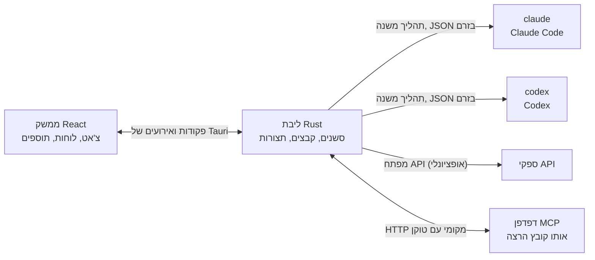

<div dir="rtl">

<p align="center">
  
</p>

<h1 align="center">LunaHarness</h1>

<p align="center">
  <a href="README.md">Português (Brasil)</a> · <a href="README.en.md">English</a> · <a href="README.es.md">Español</a> · <a href="README.fr.md">Français</a> · <a href="README.de.md">Deutsch</a> · <a href="README.it.md">Italiano</a> · <a href="README.nl.md">Nederlands</a> · <a href="README.pl.md">Polski</a> · <a href="README.sv.md">Svenska</a> · <a href="README.ru.md">Русский</a> · <a href="README.uk.md">Українська</a> · <a href="README.tr.md">Türkçe</a> · <a href="README.ar.md">العربية</a> · <strong>עברית</strong> · <a href="README.hi.md">हिन्दी</a> · <a href="README.id.md">Bahasa Indonesia</a> · <a href="README.vi.md">Tiếng Việt</a> · <a href="README.th.md">ไทย</a> · <a href="README.ja.md">日本語</a> · <a href="README.ko.md">한국어</a> · <a href="README.zh-CN.md">简体中文</a> · <a href="README.zh-TW.md">繁體中文</a>
</p>

<p align="center">
  אפליקציית שולחן עבודה לשיחה עם <strong>Claude Code</strong> ו-<strong>Codex</strong> בחלון אחד, עם תוספים, Skills, שרתי MCP ודפדפן שהסוכן יכול להשתמש בו.
</p>

---

## מה זה

LunaHarness אינו מודל בינה מלאכותית. זהו **מעטפת** סביב ממשקי שורת הפקודה הרשמיים שכבר אתם משתמשים בהם: `claude` (Claude Code) ו-`codex` (Codex). האפליקציה מפעילה את הכלים האלה, משתמשת בהתחברות שכבר ביצעתם בהם, ומציגה את השיחה בחלון צ'אט, וליד השיחה — מה שהסוכן עושה: שינויים בקבצים, תוכנית, התקדמות וטרמינל.

המטרה היא מקום אחד לעבודה עם הסוכן, בלי לאבד את מה שממשקי ה-CLI מציעים:

- החלפת ספק, מודל, רמת מאמץ ומצב הרשאות בלי להפעיל מחדש את השיחה.
- צפייה ב-diff של השינויים של הסוכן, ביטול שינויים וחזרה לנקודה קודמת.
- התקנת Skills, שרתי MCP ותוספים פעם אחת, ושימוש בהם בשני ה-CLI.
- מתן דפדפן משלו לסוכן, לקריאת דפים ולאינטראקציה איתם.

## תכונות

**שיחה**
- צ'אט עם הזרמה, צירופים של תמונות וקבצים, ותפריט `/` עם פקודות של לונה, Skills ופקודות CLI.
- מצב תכנון: התוכנית המלאה עוברת ללוח **תוכנית**, ובועת הצ'אט מציגה רק סיכום.
- דחיסת הקשר, ידנית (`/compactar`) או אוטומטית קרוב למגבלה.
- כללים גלובליים: הטקסט שאתם כותבים נכנס ל-`CLAUDE.md` ול-`AGENTS.md` של שני ה-CLI.

**חלונית צד**
- **שינויים:** רשימת הקבצים ששונו, עם diff וביטול.
- **תוכנית** ו-**התקדמות:** התוכנית של הסוכן ושלבי המשימה, לפי הסדר.
- **טרמינל:** מעטפת בתיקיית הפרויקט (`Ctrl + `` `).
- **דפדפן:** עמוד משובץ שגם הסוכן יכול לשלוט בו (ראו [מצב נוכחי](#מצב-נוכחי)).

**הרחבות**
- **Skills** ו-**שרתי MCP** מקטלוגים רשמיים או מכתובת URL, מותקנים בתצורה הגלובלית של שני ה-CLI.
- **תוספים** שמוסיפים התנהגות לצ'אט: לוחות בסרגל הצד, פקודות והתראות. תוסף ברירת מחדל, **Cache de Tokens**, מציג כמה מהפרומפט נעשה בו שימוש חוזר מהמטמון של הספק.
- סודות MCP נשארים במשתני הסביבה של המשתמש. האפליקציה לעולם לא שומרת את הערך ולא מציגה אותו.

**מראה**
- ערכות נושא בהירה וכהה, עם אפקט זכוכית אופציונלי.
- צלילי תגובה והתראות אופציונליים כשהחלון לא בפוקוס.

## איך זה עובד



- לכל CLI יש **מתאם** שמתרגם את הפלט שלו (JSON) לאירועים פנימיים. הממשק לעולם לא קורא את הפורמט הגולמי.
- האפליקציה לא שומרת את פרטי ההתחברות שלכם ל-CLI: הקובץ הרשמי מטפל בהתחברות.
- מפתחות API הם אופציונליים, לכל פרופיל, ונשמרים באחסון המאובטח של המערכת.

## הורדה

- כשתפורסם גרסה, מתקין Windows יהיה ב[דף הגרסאות](https://github.com/GuilhermeFelix95/LunaHarnes/releases).
- דרישות: Windows 10 (גרסה 1809 ומעלה) או Windows 11, ולפחות CLI אחד מותקן ומחובר (`claude` או `codex`). אין צורך ב-Node.js או ב-Rust.
- למתקין עדיין אין חתימת קוד, ולכן Windows עשוי להציג אזהרת SmartScreen. בחרו "מידע נוסף" ואז "הפעל בכל זאת".

## דרישות

- **Windows 10 או 11** (הפרויקט מוכן כרגע ל-Windows; סקריפטי הבנייה משתמשים ב-MSVC).
- **Node.js** גרסת LTS ו-**npm**.
- **Rust** (ערכת הכלים `stable`, `x86_64-pc-windows-msvc`) וכלי הבנייה של C++ מ-Visual Studio.
- לפחות CLI אחד מותקן ומחובר: Claude Code ו/או Codex.

## התקנה והרצה

```bash
git clone https://github.com/GuilhermeFelix95/LunaHarnes.git
cd LunaHarnes
npm install
```

כדי לפתוח את האפליקציה במצב פיתוח:

```bash
npm run dev:app
```

כדי לבנות את קובץ ההרצה:

```bash
npm run build:app
```

כדי להריץ רק את הממשק בדפדפן (בלי ליבת Rust, כלומר בלי ה-CLI):

```bash
npm run dev
```

## בדיקות

```bash
npm test                 # ממשק (Vitest + Testing Library)
npm run test:rust        # ליבת Rust (cargo test)
```

כשמשנים מודול, מריצים את הבדיקות שלו; הסוויטה המלאה רצה כשמבקשים אותה.

## מבנה

```
src/                 ממשק React + TypeScript (צ'אט, לוחות, תוספים)
src-tauri/src/       ליבת Rust (ספקים, סשנים, קבצים, MCP, תוספים, דפדפן)
src-tauri/marketplace/  קטלוגים רשמיים מובנים (Skills, MCP, תוספים), עם sha256
plugins-examples/    תוספי דוגמה
bin/                 הפקודה `luna` (מתקינה Skills, MCP ותוספים מהטרמינל)
docs/                מדריכים: stack, תוספים, Skills, MCP
spec/                מפרטי תכונות (מטמון פרומפט, מטמון תגובות)
```

## תיעוד

- [`docs/stack.md`](docs/stack.md): הטכנולוגיות, הארכיטקטורה, כללי הפרויקט והשינויים.
- [`docs/plugins.md`](docs/plugins.md): איך יוצרים תוספים (לונה עצמה קוראת את המדריך הזה).
- [`docs/skills.md`](docs/skills.md): איך Skills עובדים.
- [`docs/mcp.md`](docs/mcp.md): שרתי MCP וטיפול בסודות.
- [`docs/motor-proprio.md`](docs/motor-proprio.md): מחקר על מנוע עצמאי וכללי שימוש במנויים.
- [`spec/cache-de-prompt.md`](spec/cache-de-prompt.md): איך האפליקציה מודדת את המטמון של הספק.

<a id="מצב-נוכחי"></a>
## מצב נוכחי

עובד ונבדק:

- שיחה עם Claude Code ו-Codex, תכנון, התקדמות, דחיסה ו-diff.
- Skills, שרתי MCP ותוספים שהותקנו מהאפליקציה או בפקודה `luna`.
- מטמון פרומפט שנמדד בכל תור, עם התוסף Cache de Tokens.
- טרמינל משולב ו-worktrees לפי ענף.

בפיתוח, עוד לא נבדק מקצה לקצה באפליקציה:

- **דפדפן משולב:** הדף מופיע ב-webview בתוך החלון, ו-Claude מקבל את הכלים לניווט, קריאה, לחיצה והקלדה. הוא משתמש בתכונה `unstable` של Tauri. Codex עדיין לא מקבל את הכלים האלה.

## תרומה

המדריכים ב-`docs/` מסבירים את סטנדרטי הפרויקט. שינויי התנהגות מגיעים עם בדיקות, וגם `docs/stack.md` וגם `MEMORY.md` מתעדכנים יחד עם הקוד.

</div>
