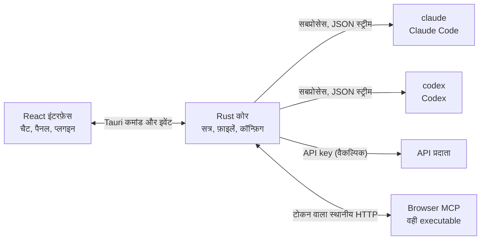

<p align="center">
  
</p>

<h1 align="center">LunaHarness</h1>

<p align="center">
  <a href="README.md">Português (Brasil)</a> · <a href="README.en.md">English</a> · <a href="README.es.md">Español</a> · <a href="README.fr.md">Français</a> · <a href="README.de.md">Deutsch</a> · <a href="README.it.md">Italiano</a> · <a href="README.nl.md">Nederlands</a> · <a href="README.pl.md">Polski</a> · <a href="README.sv.md">Svenska</a> · <a href="README.ru.md">Русский</a> · <a href="README.uk.md">Українська</a> · <a href="README.tr.md">Türkçe</a> · <a href="README.ar.md">العربية</a> · <a href="README.he.md">עברית</a> · <strong>हिन्दी</strong> · <a href="README.id.md">Bahasa Indonesia</a> · <a href="README.vi.md">Tiếng Việt</a> · <a href="README.th.md">ไทย</a> · <a href="README.ja.md">日本語</a> · <a href="README.ko.md">한국어</a> · <a href="README.zh-CN.md">简体中文</a> · <a href="README.zh-TW.md">繁體中文</a>
</p>

<p align="center">
  एक डेस्कटॉप ऐप जिससे एक ही विंडो में <strong>Claude Code</strong> और <strong>Codex</strong> से बात की जा सके, साथ में प्लगइन, skills, MCP सर्वर और एक ब्राउज़र जिसे एजेंट इस्तेमाल कर सके।
</p>

---

## यह क्या है

LunaHarness कोई AI मॉडल नहीं है। यह उन आधिकारिक CLI के ऊपर एक **आवरण** है जिनका आप पहले से उपयोग करते हैं: `claude` (Claude Code) और `codex` (Codex)। ऐप इन टूल्स को चलाता है, उनमें आपके किए लॉगिन का उपयोग करता है, और बातचीत को एक चैट विंडो में दिखाता है, साथ में यह भी कि एजेंट क्या कर रहा है: फ़ाइल बदलाव, योजना, प्रगति और एक टर्मिनल।

लक्ष्य एजेंट के साथ काम करने के लिए एक ही जगह है, बिना उन सुविधाओं को खोए जो CLI देते हैं:

- बातचीत दोबारा शुरू किए बिना प्रदाता, मॉडल, प्रयास स्तर और अनुमति मोड बदलना।
- एजेंट के बदलावों का diff देखना, बदलाव वापस लेना और किसी पिछले बिंदु पर लौटना।
- Skills, MCP सर्वर और प्लगइन एक बार इंस्टॉल करके दोनों CLI में इस्तेमाल करना।
- एजेंट को पेज पढ़ने और उनसे बातचीत करने के लिए अपना ब्राउज़र देना।

## सुविधाएँ

**बातचीत**
- स्ट्रीमिंग के साथ चैट, छवि और फ़ाइल अटैचमेंट, और Luna कमांड, skills व CLI कमांड वाला `/` मेनू।
- योजना मोड: पूरी योजना **Plan** पैनल में जाती है, और चैट बबल में केवल सारांश दिखता है।
- संदर्भ संक्षिप्त करना, मैन्युअली (`/compactar`) या सीमा के पास अपने आप।
- वैश्विक नियम: आप जो टेक्स्ट लिखते हैं वह दोनों CLI की `CLAUDE.md` और `AGENTS.md` में जाता है।

**साइड पैनल**
- **Changes:** बदली गई फ़ाइलों की सूची, diff और वापस लेने के विकल्प के साथ।
- **Plan** और **Progress:** एजेंट की योजना और कार्य के चरण, क्रम में।
- **Terminal:** प्रोजेक्ट फ़ोल्डर में एक शेल (`Ctrl + `` `).
- **Browser:** एक एम्बेडेड पेज जिसे एजेंट भी नियंत्रित कर सकता है (देखें [वर्तमान स्थिति](#वर्तमान-स्थिति))।

**एक्सटेंशन**
- आधिकारिक कैटलॉग या URL से **skills** और **MCP सर्वर**, जो दोनों CLI की वैश्विक कॉन्फ़िगरेशन में इंस्टॉल होते हैं।
- **प्लगइन** जो चैट में व्यवहार जोड़ते हैं: साइडबार पैनल, कमांड और सूचनाएँ। एक डिफ़ॉल्ट प्लगइन, **Cache de Tokens**, दिखाता है कि प्रॉम्प्ट का कितना हिस्सा प्रदाता के कैश से दोबारा उपयोग हुआ।
- MCP के गुप्त मान आपके उपयोगकर्ता के environment variables में रहते हैं। ऐप मान को कभी सेव या दिखाता नहीं है।

**दिखावट**
- हल्की और गहरी थीम, वैकल्पिक ग्लास प्रभाव के साथ।
- विंडो फ़ोकस में न होने पर वैकल्पिक उत्तर ध्वनियाँ और सूचनाएँ।

## यह कैसे काम करता है



- हर CLI का एक **adapter** होता है जो उसके JSON आउटपुट को आंतरिक इवेंट में बदलता है। इंटरफ़ेस कच्चा फ़ॉर्मेट कभी नहीं पढ़ता।
- ऐप आपकी CLI की साख नहीं रखता: लॉगिन आधिकारिक बाइनरी संभालती है।
- API keys वैकल्पिक हैं, हर प्रोफ़ाइल के लिए, और सिस्टम के सुरक्षित स्टोरेज में रखी जाती हैं।

## डाउनलोड

- जब कोई संस्करण प्रकाशित होगा, तब Windows इंस्टॉलर [रिलीज़ पेज](https://github.com/GuilhermeFelix95/LunaHarnes/releases) पर होगा।
- आवश्यकताएँ: Windows 10 (संस्करण 1809 या नया) या Windows 11, और कम से कम एक CLI इंस्टॉल और लॉग-इन किया हुआ (`claude` या `codex`)। Node.js और Rust की ज़रूरत नहीं है।
- इंस्टॉलर पर अभी कोड साइनिंग नहीं है, इसलिए Windows SmartScreen चेतावनी दिखा सकता है। "More info" चुनें और फिर "Run anyway"।

## आवश्यकताएँ

- **Windows 10 या 11** (प्रोजेक्ट अभी Windows के लिए तैयार है; बिल्ड स्क्रिप्ट MSVC का उपयोग करती हैं)।
- **Node.js** LTS और **npm**।
- **Rust** (`stable` टूलचेन, `x86_64-pc-windows-msvc`) और Visual Studio के C++ बिल्ड टूल।
- कम से कम एक CLI इंस्टॉल और लॉगिन की हुई हो: Claude Code और/या Codex।

## इंस्टॉल और चलाना

```bash
git clone https://github.com/GuilhermeFelix95/LunaHarnes.git
cd LunaHarnes
npm install
```

डेवलपमेंट मोड में ऐप खोलने के लिए:

```bash
npm run dev:app
```

executable बनाने के लिए:

```bash
npm run build:app
```

केवल इंटरफ़ेस को ब्राउज़र में चलाने के लिए (Rust कोर के बिना, यानी CLI के बिना):

```bash
npm run dev
```

## टेस्ट

```bash
npm test                 # फ़्रंटएंड (Vitest + Testing Library)
npm run test:rust        # Rust कोर (cargo test)
```

किसी मॉड्यूल को बदलने पर उसके टेस्ट चलाएँ; पूरी सूट तब चलती है जब आप उसका अनुरोध करें।

## संरचना

```
src/                 React + TypeScript इंटरफ़ेस (चैट, पैनल, प्लगइन)
src-tauri/src/       Rust कोर (प्रदाता, सत्र, फ़ाइलें, MCP, प्लगइन, ब्राउज़र)
src-tauri/marketplace/  अंतर्निहित आधिकारिक कैटलॉग (skills, MCP, प्लगइन), sha256 के साथ
plugins-examples/    संदर्भ प्लगइन
bin/                 `luna` कमांड (टर्मिनल से skills, MCP और प्लगइन इंस्टॉल करता है)
docs/                गाइड: stack, प्लगइन, skills, MCP
spec/                सुविधा विनिर्देश (प्रॉम्प्ट कैश, उत्तर कैश)
```

## दस्तावेज़ीकरण

- [`docs/stack.md`](docs/stack.md): stack, आर्किटेक्चर, प्रोजेक्ट नियम और बदलाव।
- [`docs/plugins.md`](docs/plugins.md): प्लगइन कैसे बनाएँ (इसे Luna खुद भी पढ़ती है)।
- [`docs/skills.md`](docs/skills.md): skills कैसे काम करते हैं।
- [`docs/mcp.md`](docs/mcp.md): MCP सर्वर और गुप्त मानों का प्रबंधन।
- [`docs/motor-proprio.md`](docs/motor-proprio.md): अपने इंजन पर अध्ययन और सब्सक्रिप्शन उपयोग के नियम।
- [`spec/cache-de-prompt.md`](spec/cache-de-prompt.md): ऐप प्रदाता के कैश को कैसे मापता है।

<a id="वर्तमान-स्थिति"></a>
## वर्तमान स्थिति

काम कर रहा है और परीक्षण किया गया:

- Claude Code और Codex के साथ बातचीत, योजना, प्रगति, संक्षेपण और diff।
- ऐप या `luna` कमांड से इंस्टॉल किए गए skills, MCP सर्वर और प्लगइन।
- हर टर्न में मापा गया प्रॉम्प्ट कैश, Cache de Tokens प्लगइन के साथ।
- एकीकृत टर्मिनल और शाखा के अनुसार worktrees।

विकास में, ऐप में पूरी तरह (end to end) अभी सत्यापित नहीं:

- **एकीकृत ब्राउज़र:** पेज विंडो के अंदर एक webview में दिखता है, और Claude को नेविगेट, पढ़ने, क्लिक और टाइप करने के टूल मिलते हैं। यह Tauri की `unstable` सुविधा का उपयोग करता है। Codex को ये टूल अभी नहीं मिलते।

## योगदान

`docs/` के गाइड प्रोजेक्ट के मानक समझाते हैं। व्यवहार में बदलाव टेस्ट के साथ आते हैं, और `docs/stack.md` व `MEMORY.md` कोड के साथ अपडेट होते हैं।
