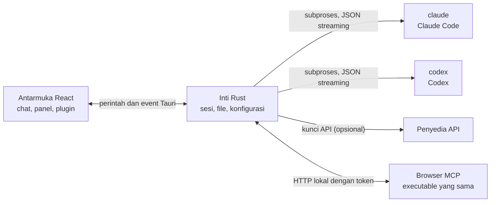

<p align="center">
  
</p>

<h1 align="center">LunaHarness</h1>

<p align="center">
  <a href="README.md">Português (Brasil)</a> · <a href="README.en.md">English</a> · <a href="README.es.md">Español</a> · <a href="README.fr.md">Français</a> · <a href="README.de.md">Deutsch</a> · <a href="README.it.md">Italiano</a> · <a href="README.nl.md">Nederlands</a> · <a href="README.pl.md">Polski</a> · <a href="README.sv.md">Svenska</a> · <a href="README.ru.md">Русский</a> · <a href="README.uk.md">Українська</a> · <a href="README.tr.md">Türkçe</a> · <a href="README.ar.md">العربية</a> · <a href="README.he.md">עברית</a> · <a href="README.hi.md">हिन्दी</a> · <strong>Bahasa Indonesia</strong> · <a href="README.vi.md">Tiếng Việt</a> · <a href="README.th.md">ไทย</a> · <a href="README.ja.md">日本語</a> · <a href="README.ko.md">한국어</a> · <a href="README.zh-CN.md">简体中文</a> · <a href="README.zh-TW.md">繁體中文</a>
</p>

<p align="center">
  Aplikasi desktop untuk berbicara dengan <strong>Claude Code</strong> dan <strong>Codex</strong> dalam satu jendela, dengan plugin, skill, server MCP, dan browser yang bisa digunakan agen.
</p>

---

## Apa itu

LunaHarness bukan model AI. Ini adalah **cangkang** di sekitar CLI resmi yang sudah Anda gunakan: `claude` (Claude Code) dan `codex` (Codex). Aplikasi menjalankan alat-alat tersebut, memakai login yang sudah Anda lakukan di dalamnya, dan menampilkan percakapan dalam jendela chat, dengan apa yang dilakukan agen di sebelahnya: perubahan file, rencana, progres, dan terminal.

Tujuannya adalah satu tempat untuk bekerja dengan agen, tanpa kehilangan kemampuan yang ditawarkan CLI:

- Mengganti penyedia, model, tingkat usaha, dan mode izin tanpa memulai ulang percakapan.
- Melihat diff perubahan agen, membatalkan perubahan, dan kembali ke titik sebelumnya.
- Memasang skill, server MCP, dan plugin sekali saja, lalu memakainya di kedua CLI.
- Memberi agen browser sendiri untuk membaca halaman dan berinteraksi dengannya.

## Fitur

**Percakapan**
- Chat dengan streaming, lampiran gambar dan file, serta menu `/` dengan perintah Luna, skill, dan perintah CLI.
- Mode perencanaan: rencana lengkap masuk ke panel **Rencana**, dan balon chat hanya menampilkan ringkasan.
- Pemadatan konteks, secara manual (`/compactar`) atau otomatis mendekati batas.
- Aturan global: teks yang Anda tulis masuk ke `CLAUDE.md` dan `AGENTS.md` kedua CLI.

**Panel samping**
- **Perubahan:** daftar file yang berubah, dengan diff dan pembatalan.
- **Rencana** dan **Progres:** rencana agen dan langkah-langkah tugas, berurutan.
- **Terminal:** shell di folder proyek (`Ctrl + `` `).
- **Browser:** halaman tertanam yang juga bisa dikendalikan agen (lihat [Status saat ini](#status-saat-ini)).

**Ekstensi**
- **Skill** dan **server MCP** dari katalog resmi atau melalui URL, dipasang di konfigurasi global kedua CLI.
- **Plugin** yang menambah perilaku ke chat: panel di sidebar, perintah, dan notifikasi. Plugin bawaan, **Cache de Tokens**, menunjukkan berapa bagian prompt yang dipakai ulang dari cache penyedia.
- Rahasia MCP tetap berada di variabel lingkungan pengguna Anda. Aplikasi tidak pernah menyimpan atau menampilkan nilainya.

**Tampilan**
- Tema terang dan gelap, dengan efek kaca opsional.
- Suara respons dan notifikasi opsional saat jendela tidak sedang fokus.

## Cara kerjanya



- Setiap CLI punya **adapter** yang menerjemahkan keluaran JSON-nya menjadi event internal. Antarmuka tidak pernah membaca format mentah.
- Aplikasi tidak menyimpan kredensial CLI Anda: biner resmi yang menangani login.
- Kunci API bersifat opsional, per profil, dan disimpan di penyimpanan aman sistem.

## Persyaratan

- **Windows 10 atau 11** (proyek ini saat ini disiapkan untuk Windows; skrip build memakai MSVC).
- **Node.js** LTS dan **npm**.
- **Rust** (toolchain `stable`, `x86_64-pc-windows-msvc`) dan alat build C++ dari Visual Studio.
- Setidaknya satu CLI terpasang dan sudah login: Claude Code dan/atau Codex.

## Instalasi dan menjalankan

```bash
git clone https://github.com/GuilhermeFelix95/LunaHarnes.git
cd LunaHarnes
npm install
```

Untuk membuka aplikasi dalam mode pengembangan:

```bash
npm run dev:app
```

Untuk membangun executable:

```bash
npm run build:app
```

Untuk menjalankan antarmuka saja di browser (tanpa inti Rust, jadi tanpa CLI):

```bash
npm run dev
```

## Pengujian

```bash
npm test                 # frontend (Vitest + Testing Library)
npm run test:rust        # inti Rust (cargo test)
```

Saat mengubah sebuah modul, jalankan pengujiannya; rangkaian lengkap dijalankan saat Anda memintanya.

## Struktur

```
src/                 antarmuka React + TypeScript (chat, panel, plugin)
src-tauri/src/       inti Rust (penyedia, sesi, file, MCP, plugin, browser)
src-tauri/marketplace/  katalog resmi bawaan (skill, MCP, plugin), dengan sha256
plugins-examples/    plugin referensi
bin/                 perintah `luna` (memasang skill, MCP, dan plugin dari terminal)
docs/                panduan: stack, plugin, skill, MCP
spec/                spesifikasi fitur (cache prompt, cache respons)
```

## Dokumentasi

- [`docs/stack.md`](docs/stack.md): stack, arsitektur, aturan proyek, dan perubahan.
- [`docs/plugins.md`](docs/plugins.md): cara membuat plugin (juga dibaca oleh Luna sendiri).
- [`docs/skills.md`](docs/skills.md): cara kerja skill.
- [`docs/mcp.md`](docs/mcp.md): server MCP dan cara menangani rahasia.
- [`docs/motor-proprio.md`](docs/motor-proprio.md): kajian tentang mesin sendiri dan aturan penggunaan langganan.
- [`spec/cache-de-prompt.md`](spec/cache-de-prompt.md): cara aplikasi mengukur cache penyedia.

<a id="status-saat-ini"></a>
## Status saat ini

Berfungsi dan sudah diuji:

- Percakapan dengan Claude Code dan Codex, perencanaan, progres, pemadatan, dan diff.
- Skill, server MCP, dan plugin yang dipasang dari aplikasi atau perintah `luna`.
- Cache prompt yang diukur per giliran, dengan plugin Cache de Tokens.
- Terminal terintegrasi dan worktree per cabang.

Sedang dikembangkan, belum diverifikasi dari awal sampai akhir di aplikasi:

- **Browser terintegrasi:** halaman muncul di webview di dalam jendela, dan Claude menerima alat untuk navigasi, membaca, mengklik, dan mengetik. Ini memakai fitur `unstable` dari Tauri. Codex belum menerima alat-alat ini.

## Berkontribusi

Panduan di `docs/` menjelaskan standar proyek. Perubahan perilaku disertai pengujian, dan `docs/stack.md` serta `MEMORY.md` diperbarui bersama kode.
