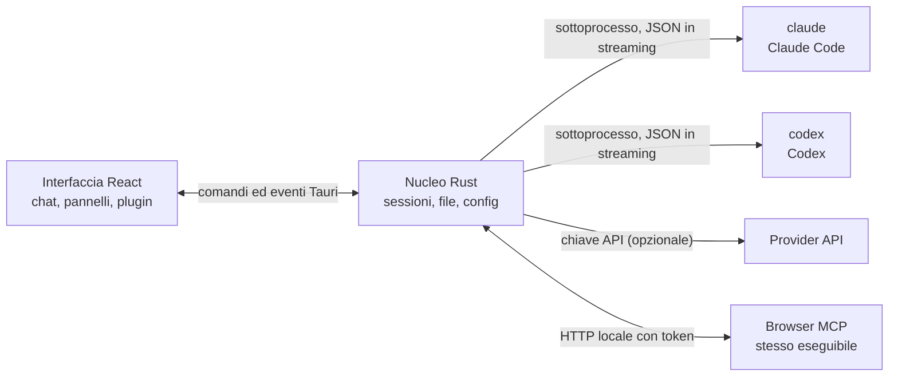

<p align="center">
  
</p>

<h1 align="center">LunaHarness</h1>

<p align="center">
  <a href="README.md">Português (Brasil)</a> · <a href="README.en.md">English</a> · <a href="README.es.md">Español</a> · <a href="README.fr.md">Français</a> · <a href="README.de.md">Deutsch</a> · <strong>Italiano</strong> · <a href="README.nl.md">Nederlands</a> · <a href="README.pl.md">Polski</a> · <a href="README.sv.md">Svenska</a> · <a href="README.ru.md">Русский</a> · <a href="README.uk.md">Українська</a> · <a href="README.tr.md">Türkçe</a> · <a href="README.ar.md">العربية</a> · <a href="README.he.md">עברית</a> · <a href="README.hi.md">हिन्दी</a> · <a href="README.id.md">Bahasa Indonesia</a> · <a href="README.vi.md">Tiếng Việt</a> · <a href="README.th.md">ไทย</a> · <a href="README.ja.md">日本語</a> · <a href="README.ko.md">한국어</a> · <a href="README.zh-CN.md">简体中文</a> · <a href="README.zh-TW.md">繁體中文</a>
</p>

<p align="center">
  Un'app desktop per parlare con <strong>Claude Code</strong> e <strong>Codex</strong> in un'unica finestra, con plugin, skill, server MCP e un browser che l'agente può usare.
</p>

---

## Cos'è

LunaHarness non è un modello di IA. È un **guscio** attorno alle CLI ufficiali che usi già: `claude` (Claude Code) e `codex` (Codex). L'app avvia questi strumenti, usa il login che hai già fatto in ciascuno e mostra la conversazione in una finestra di chat, con accanto ciò che fa l'agente: modifiche ai file, piano, progressi e un terminale.

L'obiettivo è avere un unico posto per lavorare con l'agente, senza perdere ciò che offrono le CLI:

- Cambiare provider, modello, sforzo e modalità di permesso senza riavviare la conversazione.
- Vedere il diff delle modifiche dell'agente, annullare cambiamenti e tornare a un punto precedente.
- Installare skill, server MCP e plugin una volta sola e usarli in entrambe le CLI.
- Dare all'agente un proprio browser per leggere pagine e interagire con esse.

## Funzionalità

**Conversazione**
- Chat con streaming, allegati di immagini e file, e un menu `/` con comandi di Luna, skill e comandi delle CLI.
- Modalità piano: il piano completo va nel pannello **Piano**, e il fumetto della chat mostra solo un riassunto.
- Compattazione del contesto, manuale (`/compactar`) o automatica vicino al limite.
- Regole globali: il testo che scrivi finisce nel `CLAUDE.md` e nell'`AGENTS.md` di entrambe le CLI.

**Pannello laterale**
- **Modifiche:** elenco dei file cambiati, con diff e annullamento.
- **Piano** e **Progresso:** il piano dell'agente e i passi del compito, in ordine.
- **Terminale:** una shell nella cartella del progetto (`Ctrl + `` `).
- **Browser:** una pagina incorporata che l'agente può controllare (vedi [Stato attuale](#stato-attuale)).

**Estensioni**
- **Skill** e **server MCP** da cataloghi ufficiali o da URL, installati nella configurazione globale di entrambe le CLI.
- **Plugin** che aggiungono comportamenti alla chat: pannelli nella barra laterale, comandi e avvisi. Un plugin predefinito, **Cache de Tokens**, mostra quanto del prompt è stato riusato dalla cache del provider.
- I segreti MCP restano nelle variabili d'ambiente del tuo utente. L'app non salva né mostra mai il valore.

**Aspetto**
- Temi chiaro e scuro, con effetto vetro opzionale.
- Suoni di risposta opzionali e avvisi quando la finestra non è in primo piano.

## Come funziona



- Ogni CLI ha un **adattatore** che traduce il suo output JSON in eventi interni. Il frontend non legge mai il formato grezzo.
- L'app non conserva le tue credenziali delle CLI: è il binario ufficiale a gestire il login.
- Le chiavi API sono facoltative, per profilo, e sono salvate nell'archiviazione sicura del sistema.

## Download

- Quando sarà pubblicata una versione, l'installer per Windows sarà nella [pagina delle release](https://github.com/GuilhermeFelix95/lunaCode/releases).
- Requisiti: Windows 10 (versione 1809 o successiva) o Windows 11, e almeno una CLI installata e con accesso effettuato (`claude` o `codex`). Non servono Node.js né Rust.
- L'installer non è ancora firmato digitalmente, quindi Windows può mostrare un avviso di SmartScreen. Scegli "Ulteriori informazioni" e poi "Esegui comunque".

## Requisiti

- **Windows 10 o 11** (il progetto oggi è predisposto per Windows; gli script di build usano MSVC).
- **Node.js** LTS e **npm**.
- **Rust** (toolchain `stable`, `x86_64-pc-windows-msvc`) e gli strumenti di build C++ di Visual Studio.
- Almeno una CLI installata e con accesso: Claude Code e/o Codex.

## Installazione ed esecuzione

```bash
git clone https://github.com/GuilhermeFelix95/lunaCode.git
cd LunaHarnes
npm install
```

Per aprire l'app in modalità sviluppo:

```bash
npm run dev:app
```

Per generare l'eseguibile:

```bash
npm run build:app
```

Per avviare solo l'interfaccia nel browser (senza il nucleo Rust, quindi senza CLI):

```bash
npm run dev
```

## Test

```bash
npm test                 # frontend (Vitest + Testing Library)
npm run test:rust        # nucleo Rust (cargo test)
```

Quando modifichi un modulo, esegui i suoi test; la suite completa serve quando la richiedi.

## Struttura

```
src/                 interfaccia React + TypeScript (chat, pannelli, plugin)
src-tauri/src/       nucleo Rust (provider, sessioni, file, MCP, plugin, browser)
src-tauri/marketplace/  cataloghi ufficiali inclusi (skill, MCP, plugin), con sha256
plugins-examples/    plugin di riferimento
bin/                 comando `luna` (installa skill, MCP e plugin dal terminale)
docs/                guide: stack, plugin, skill, MCP
spec/                specifiche delle funzioni (cache del prompt, cache delle risposte)
```

## Documentazione

- [`docs/stack.md`](docs/stack.md): stack, architettura, regole del progetto e modifiche.
- [`docs/plugins.md`](docs/plugins.md): come creare plugin (letto anche da Luna stessa).
- [`docs/skills.md`](docs/skills.md): come funzionano le skill.
- [`docs/mcp.md`](docs/mcp.md): server MCP e gestione dei segreti.
- [`docs/motor-proprio.md`](docs/motor-proprio.md): studio su un motore proprio e regole di uso degli abbonamenti.
- [`spec/cache-de-prompt.md`](spec/cache-de-prompt.md): come l'app misura la cache del provider.

## Stato attuale

Funzionante e testato:

- Conversazione con Claude Code e Codex, pianificazione, progressi, compattazione e diff.
- Skill, server MCP e plugin installati dall'app o dal comando `luna`.
- Cache del prompt misurata per turno, con il plugin Cache de Tokens.
- Terminale integrato e worktree per branch.

In sviluppo, non ancora verificato end-to-end nell'app:

- **Browser integrato:** la pagina appare in una webview dentro la finestra, e Claude riceve gli strumenti per navigare, leggere, cliccare e digitare. Usa una funzione `unstable` di Tauri. Codex non riceve ancora questi strumenti.

## Contribuire

Le guide in `docs/` spiegano gli standard del progetto. Le modifiche di comportamento arrivano con i test, e `docs/stack.md` e `MEMORY.md` vengono aggiornati insieme al codice.
