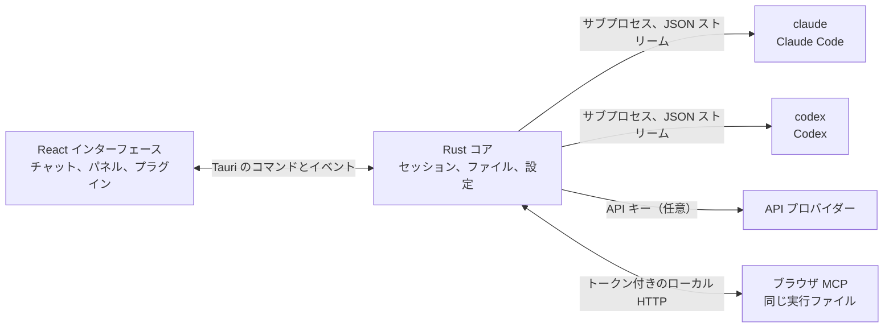

<p align="center">
  
</p>

<h1 align="center">LunaHarness</h1>

<p align="center">
  <a href="README.md">Português (Brasil)</a> · <a href="README.en.md">English</a> · <a href="README.es.md">Español</a> · <a href="README.fr.md">Français</a> · <a href="README.de.md">Deutsch</a> · <a href="README.it.md">Italiano</a> · <a href="README.nl.md">Nederlands</a> · <a href="README.pl.md">Polski</a> · <a href="README.sv.md">Svenska</a> · <a href="README.ru.md">Русский</a> · <a href="README.uk.md">Українська</a> · <a href="README.tr.md">Türkçe</a> · <a href="README.ar.md">العربية</a> · <a href="README.he.md">עברית</a> · <a href="README.hi.md">हिन्दी</a> · <a href="README.id.md">Bahasa Indonesia</a> · <a href="README.vi.md">Tiếng Việt</a> · <a href="README.th.md">ไทย</a> · <strong>日本語</strong> · <a href="README.ko.md">한국어</a> · <a href="README.zh-CN.md">简体中文</a> · <a href="README.zh-TW.md">繁體中文</a>
</p>

<p align="center">
  <strong>Claude Code</strong> と <strong>Codex</strong> を 1 つのウィンドウで使えるデスクトップアプリです。プラグイン、スキル、MCP サーバー、そしてエージェントが操作できるブラウザを備えています。
</p>

---

## これは何か

LunaHarness は AI モデルではありません。すでに使っている公式 CLI、`claude`（Claude Code）と `codex`（Codex）を包む**シェル**です。アプリはこれらのツールを起動し、各ツールで済ませたログインをそのまま使い、会話をチャットウィンドウに表示します。その横には、エージェントが行っていることも表示されます。ファイルの変更、計画、進捗、ターミナルです。

目的は、CLI の機能を失うことなく、エージェントと作業する場所を 1 つにまとめることです。

- 会話を再開せずに、プロバイダー、モデル、思考の強度、権限モードを切り替えられます。
- エージェントが行った変更の diff を確認し、変更を取り消して以前の時点に戻れます。
- スキル、MCP サーバー、プラグインを一度インストールすれば、両方の CLI で使えます。
- エージェントに専用のブラウザを持たせ、ページを読んだり操作したりさせられます。

## 機能

**会話**
- ストリーミング表示のチャット、画像とファイルの添付、そして Luna のコマンド、スキル、CLI のコマンドを並べた `/` メニュー。
- 計画モード: 計画の全文は **Plan** パネルに表示され、チャットの吹き出しには要約だけが表示されます。
- コンテキストの圧縮。手動（`/compactar`）でも、上限に近づくと自動でも行えます。
- グローバルルール: 入力したテキストは両方の CLI の `CLAUDE.md` と `AGENTS.md` に反映されます。

**サイドパネル**
- **Changes:** 変更されたファイルの一覧。diff と取り消しができます。
- **Plan** と **Progress:** エージェントの計画と、タスクのステップを順番に表示します。
- **Terminal:** プロジェクトフォルダで動くシェル（`Ctrl + `` `）。
- **Browser:** 埋め込みのページ。エージェントも操作できます（[現在の状態](#現在の状態)を参照）。

**拡張機能**
- 公式カタログまたは URL から取得する**スキル**と **MCP サーバー**。両方の CLI のグローバル設定にインストールされます。
- チャットに機能を追加する**プラグイン**: サイドバーのパネル、コマンド、通知。既定のプラグイン **Cache de Tokens** は、プロンプトのうちプロバイダーのキャッシュから再利用された割合を表示します。
- MCP のシークレットはユーザーの環境変数に残ります。アプリが値を保存したり表示したりすることはありません。

**見た目**
- ライトテーマとダークテーマ。ガラス風の効果は任意です。
- ウィンドウがフォーカスされていないときの応答音と通知は任意です。

## 仕組み



- 各 CLI には、その JSON 出力を内部イベントに変換する**アダプター**があります。インターフェースが生の形式を読むことはありません。
- アプリは CLI の認証情報を保持しません。ログインは公式のバイナリが処理します。
- API キーは任意で、プロファイルごとに設定し、システムの安全なストレージに保存されます。

## ダウンロード

- バージョンが公開されると、Windows 用のインストーラーは[リリースページ](https://github.com/GuilhermeFelix95/LunaHarnes/releases)にあります。
- 必要な環境: Windows 10（バージョン 1809 以降）または Windows 11、そして CLI（`claude` または `codex`）を 1 つ以上インストールし、ログイン済みであること。Node.js と Rust は不要です。
- インストーラーにはまだコード署名がないため、Windows の SmartScreen の警告が表示されることがあります。「詳細情報」を選び、「実行」を選択してください。

## 必要な環境

- **Windows 10 または 11**（現時点のプロジェクトは Windows 向けです。ビルドスクリプトは MSVC を使います）。
- **Node.js**（LTS）と **npm**。
- **Rust**（`stable` ツールチェーン、`x86_64-pc-windows-msvc`）と、Visual Studio の C++ ビルドツール。
- 少なくとも 1 つの CLI がインストールされ、ログイン済みであること: Claude Code か Codex、または両方。

## インストールと実行

```bash
git clone https://github.com/GuilhermeFelix95/LunaHarnes.git
cd LunaHarnes
npm install
```

開発モードでアプリを開くには:

```bash
npm run dev:app
```

実行ファイルをビルドするには:

```bash
npm run build:app
```

インターフェースだけをブラウザで動かすには（Rust コアがないため、CLI は使えません）:

```bash
npm run dev
```

## テスト

```bash
npm test                 # フロントエンド（Vitest + Testing Library）
npm run test:rust        # Rust コア（cargo test）
```

モジュールを変更したら、そのモジュールのテストを実行してください。全体のテストは、必要なときに実行します。

## 構成

```
src/                 React + TypeScript のインターフェース（チャット、パネル、プラグイン）
src-tauri/src/       Rust コア（プロバイダー、セッション、ファイル、MCP、プラグイン、ブラウザ）
src-tauri/marketplace/  同梱の公式カタログ（スキル、MCP、プラグイン）、sha256 付き
plugins-examples/    参考用プラグイン
bin/                 `luna` コマンド（ターミナルからスキル、MCP、プラグインをインストール）
docs/                ガイド: stack、プラグイン、スキル、MCP
spec/                機能仕様（プロンプトキャッシュ、応答キャッシュ）
```

## ドキュメント

- [`docs/stack.md`](docs/stack.md): 技術スタック、アーキテクチャ、プロジェクトのルール、変更履歴。
- [`docs/plugins.md`](docs/plugins.md): プラグインの作り方（Luna 自身も読みます）。
- [`docs/skills.md`](docs/skills.md): スキルの仕組み。
- [`docs/mcp.md`](docs/mcp.md): MCP サーバーとシークレットの扱い。
- [`docs/motor-proprio.md`](docs/motor-proprio.md): 独自エンジンの検討と、サブスクリプションの利用ルール。
- [`spec/cache-de-prompt.md`](spec/cache-de-prompt.md): アプリがプロバイダーのキャッシュを測定する方法。

<a id="現在の状態"></a>
## 現在の状態

動作し、テスト済みの機能:

- Claude Code と Codex との会話、計画、進捗、圧縮、diff。
- アプリまたは `luna` コマンドからインストールしたスキル、MCP サーバー、プラグイン。
- ターンごとに測定するプロンプトキャッシュと、Cache de Tokens プラグイン。
- 統合ターミナルと、ブランチごとの worktree。

開発中で、アプリ内でのエンドツーエンドの確認はまだの機能:

- **統合ブラウザ:** ウィンドウ内の webview にページが表示され、Claude にはページ移動、読み取り、クリック、入力のツールが与えられます。Tauri の `unstable` 機能を使っています。Codex にはまだこれらのツールが与えられていません。

## 貢献

`docs/` のガイドにプロジェクトの基準が書かれています。動作の変更にはテストを添え、`docs/stack.md` と `MEMORY.md` はコードと一緒に更新します。
