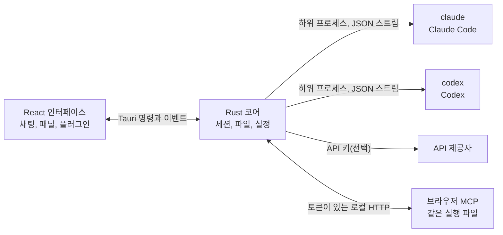

<p align="center">
  
</p>

<h1 align="center">LunaHarness</h1>

<p align="center">
  <a href="README.md">Português (Brasil)</a> · <a href="README.en.md">English</a> · <a href="README.es.md">Español</a> · <a href="README.fr.md">Français</a> · <a href="README.de.md">Deutsch</a> · <a href="README.it.md">Italiano</a> · <a href="README.nl.md">Nederlands</a> · <a href="README.pl.md">Polski</a> · <a href="README.sv.md">Svenska</a> · <a href="README.ru.md">Русский</a> · <a href="README.uk.md">Українська</a> · <a href="README.tr.md">Türkçe</a> · <a href="README.ar.md">العربية</a> · <a href="README.he.md">עברית</a> · <a href="README.hi.md">हिन्दी</a> · <a href="README.id.md">Bahasa Indonesia</a> · <a href="README.vi.md">Tiếng Việt</a> · <a href="README.th.md">ไทย</a> · <a href="README.ja.md">日本語</a> · <strong>한국어</strong> · <a href="README.zh-CN.md">简体中文</a> · <a href="README.zh-TW.md">繁體中文</a>
</p>

<p align="center">
  하나의 창에서 <strong>Claude Code</strong>와 <strong>Codex</strong>와 대화할 수 있는 데스크톱 앱입니다. 플러그인, 스킬, MCP 서버, 그리고 에이전트가 사용할 수 있는 브라우저를 포함합니다.
</p>

---

## 무엇인가요

LunaHarness는 AI 모델이 아닙니다. 이미 사용 중인 공식 CLI인 `claude`(Claude Code)와 `codex`(Codex)를 감싸는 **껍데기**입니다. 앱은 이 도구들을 실행하고, 각 도구에서 이미 한 로그인을 그대로 사용하며, 대화를 채팅 창에 보여줍니다. 옆에는 에이전트가 하고 있는 일이 표시됩니다. 파일 변경, 계획, 진행 상황, 터미널이 그것입니다.

목표는 CLI가 제공하는 기능을 잃지 않으면서, 에이전트와 일할 수 있는 곳을 하나로 모으는 것입니다.

- 대화를 다시 시작하지 않고 제공자, 모델, 노력 수준, 권한 모드를 바꿀 수 있습니다.
- 에이전트가 바꾼 내용의 diff를 보고, 변경을 되돌리고, 이전 시점으로 돌아갈 수 있습니다.
- 스킬, MCP 서버, 플러그인을 한 번 설치하면 두 CLI 모두에서 사용할 수 있습니다.
- 에이전트에게 페이지를 읽고 상호작용할 수 있는 자체 브라우저를 줄 수 있습니다.

## 기능

**대화**
- 스트리밍 응답이 나오는 채팅, 이미지와 파일 첨부, 그리고 Luna 명령, 스킬, CLI 명령이 들어 있는 `/` 메뉴.
- 계획 모드: 전체 계획은 **계획** 패널에 나오고, 채팅 말풍선에는 요약만 나옵니다.
- 컨텍스트 압축. 직접 실행(`/compactar`)하거나, 한도에 가까워지면 자동으로 실행할 수 있습니다.
- 전역 규칙: 입력한 텍스트는 두 CLI의 `CLAUDE.md`와 `AGENTS.md`에 반영됩니다.

**사이드 패널**
- **변경 사항:** 바뀐 파일 목록. diff와 되돌리기를 지원합니다.
- **계획**과 **진행:** 에이전트의 계획과 작업 단계를 순서대로 보여 줍니다.
- **터미널:** 프로젝트 폴더에서 열리는 셸(`Ctrl + `` `).
- **브라우저:** 에이전트도 조작할 수 있는 내장 페이지([현재 상태](#현재-상태) 참고).

**확장 기능**
- 공식 카탈로그나 URL에서 가져오는 **스킬**과 **MCP 서버**. 두 CLI의 전역 설정에 설치됩니다.
- 채팅에 동작을 추가하는 **플러그인**: 사이드바 패널, 명령, 알림. 기본 플러그인 **Cache de Tokens**는 프롬프트 중 제공자의 캐시에서 다시 쓰인 비율을 보여 줍니다.
- MCP 비밀 값은 사용자의 환경 변수에 남습니다. 앱은 값을 저장하거나 보여 주지 않습니다.

**모양**
- 밝은 테마와 어두운 테마. 유리 효과는 선택 사항입니다.
- 창이 포커스되어 있지 않을 때 나오는 응답 소리와 알림은 선택 사항입니다.

## 작동 방식



- 각 CLI에는 JSON 출력을 내부 이벤트로 바꾸는 **어댑터**가 있습니다. 인터페이스는 원시 형식을 직접 읽지 않습니다.
- 앱은 CLI 인증 정보를 저장하지 않습니다. 로그인은 공식 바이너리가 처리합니다.
- API 키는 선택 사항이며 프로필마다 설정하고, 시스템의 보안 저장소에 보관합니다.

## 다운로드

- 버전이 공개되면 Windows 설치 프로그램은 [릴리스 페이지](https://github.com/GuilhermeFelix95/lunaCode/releases)에 있습니다.
- 요구 사항: Windows 10(1809 버전 이상) 또는 Windows 11, 그리고 설치되고 로그인된 CLI(`claude` 또는 `codex`)가 하나 이상 필요합니다. Node.js와 Rust는 필요하지 않습니다.
- 설치 프로그램에 아직 코드 서명이 없어서 Windows가 SmartScreen 경고를 표시할 수 있습니다. "추가 정보"를 선택한 뒤 "실행"을 선택하세요.

## 요구 사항

- **Windows 10 또는 11**(현재 프로젝트는 Windows용으로 준비되어 있으며, 빌드 스크립트는 MSVC를 사용합니다).
- **Node.js** LTS와 **npm**.
- **Rust**(`stable` 툴체인, `x86_64-pc-windows-msvc`)와 Visual Studio의 C++ 빌드 도구.
- 최소 하나의 CLI가 설치되어 있고 로그인되어 있어야 합니다: Claude Code 및/또는 Codex.

## 설치와 실행

```bash
git clone https://github.com/GuilhermeFelix95/lunaCode.git
cd LunaHarnes
npm install
```

개발 모드로 앱을 열려면:

```bash
npm run dev:app
```

실행 파일을 빌드하려면:

```bash
npm run build:app
```

인터페이스만 브라우저에서 실행하려면(Rust 코어가 없으므로 CLI는 사용할 수 없습니다):

```bash
npm run dev
```

## 테스트

```bash
npm test                 # 프런트엔드(Vitest + Testing Library)
npm run test:rust        # Rust 코어(cargo test)
```

모듈을 바꿨다면 그 모듈의 테스트를 실행하세요. 전체 테스트 모음은 요청할 때 실행합니다.

## 구조

```
src/                 React + TypeScript 인터페이스(채팅, 패널, 플러그인)
src-tauri/src/       Rust 코어(제공자, 세션, 파일, MCP, 플러그인, 브라우저)
src-tauri/marketplace/  내장 공식 카탈로그(스킬, MCP, 플러그인), sha256 포함
plugins-examples/    참고용 플러그인
bin/                 `luna` 명령(터미널에서 스킬, MCP, 플러그인 설치)
docs/                가이드: stack, 플러그인, 스킬, MCP
spec/                기능 명세(프롬프트 캐시, 응답 캐시)
```

## 문서

- [`docs/stack.md`](docs/stack.md): 스택, 아키텍처, 프로젝트 규칙과 변경 사항.
- [`docs/plugins.md`](docs/plugins.md): 플러그인을 만드는 방법(Luna도 이 문서를 읽습니다).
- [`docs/skills.md`](docs/skills.md): 스킬의 작동 방식.
- [`docs/mcp.md`](docs/mcp.md): MCP 서버와 비밀 값을 다루는 방법.
- [`docs/motor-proprio.md`](docs/motor-proprio.md): 자체 엔진에 대한 검토와 구독 사용 규칙.
- [`spec/cache-de-prompt.md`](spec/cache-de-prompt.md): 앱이 제공자 캐시를 측정하는 방법.

<a id="현재-상태"></a>
## 현재 상태

작동하며 테스트된 기능:

- Claude Code와 Codex와의 대화, 계획, 진행, 압축, diff.
- 앱이나 `luna` 명령으로 설치한 스킬, MCP 서버, 플러그인.
- 턴마다 측정하는 프롬프트 캐시와 Cache de Tokens 플러그인.
- 통합 터미널과 브랜치별 worktree.

개발 중이며, 앱에서 end-to-end로 아직 검증하지 않은 기능:

- **통합 브라우저:** 창 안의 webview에 페이지가 표시되고, Claude는 이동, 읽기, 클릭, 입력 도구를 받습니다. Tauri의 `unstable` 기능을 사용합니다. Codex는 아직 이 도구를 받지 못합니다.

## 기여

`docs/`의 가이드에 프로젝트 기준이 설명되어 있습니다. 동작을 바꾸는 변경에는 테스트가 함께 들어가고, `docs/stack.md`와 `MEMORY.md`는 코드와 함께 업데이트합니다.
