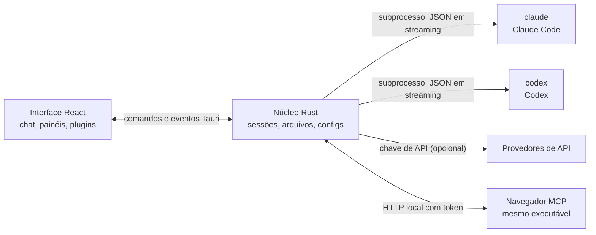

<p align="center">
  
</p>

<h1 align="center">LunaHarness</h1>

<p align="center">
  Um app desktop para conversar com o <strong>Claude Code</strong> e o <strong>Codex</strong> numa interface só, com plugins, skills, servidores MCP e um navegador para o agente.
</p>

---

## O que é

O LunaHarness não é um modelo de IA. Ele é uma **casca** em volta das CLIs oficiais que você já usa: o `claude` (Claude Code) e o `codex` (Codex). O app inicia essas ferramentas, usa o login que você já fez nelas e mostra a conversa numa janela de chat, com o que o agente faz ao lado: alterações de arquivos, plano, progresso e um terminal.

A ideia é ter um lugar só para trabalhar com o agente, sem perder o que as CLIs oferecem:

- Trocar de provedor, modelo, esforço e modo de permissão sem reiniciar a conversa.
- Ver o diff do que o agente mudou, desfazer alterações e voltar a um ponto anterior.
- Instalar skills, servidores MCP e plugins uma vez e usar nas duas CLIs.
- Dar ao agente um navegador próprio para ler e interagir com páginas.

## Recursos

**Conversa**
- Chat com streaming, anexos de imagem e de arquivo, e menu `/` com comandos da Luna, skills e comandos das CLIs.
- Modo de planejamento: o plano completo fica no painel **Plano**, e o balão do chat mostra só o resumo.
- Compactação de contexto, manual (`/compactar`) ou automática perto do limite.
- Regras globais: um texto seu que vai para o `CLAUDE.md` e o `AGENTS.md` das duas CLIs.

**Painel lateral**
- **Alterações:** lista de arquivos mudados, com diff e desfazer.
- **Plano** e **Progresso:** o plano do agente e as etapas da tarefa, em ordem.
- **Terminal:** um shell na pasta do projeto (`Ctrl + `` `).
- **Navegador:** uma página embutida, que o agente também pode controlar (ver [Estado atual](#estado-atual)).

**Extensões**
- **Skills** e **servidores MCP** em catálogos oficiais ou por URL. Instalados nas configurações globais das duas CLIs.
- **Plugins** que acrescentam comportamento ao chat: painéis na barra lateral, comandos e avisos. Um plugin padrão, o **Cache de Tokens**, mostra quanto do prompt foi reaproveitado do cache do provedor.
- Segredos de MCP ficam nas variáveis de ambiente do seu usuário. O app nunca guarda nem mostra o valor.

**Visual**
- Temas claros e noturnos, com opção de efeito de vidro.
- Sons de resposta opcionais e avisos quando a janela não está em foco.

## Como funciona



- Cada CLI tem um **adaptador** que traduz a saída JSON dela para eventos internos. O frontend nunca lê o formato bruto.
- O app não guarda suas credenciais das CLIs: quem faz o login é o próprio binário oficial.
- Chaves de API são opcionais, por perfil, e ficam no armazenamento seguro do sistema.

## Pré-requisitos

- **Windows 10 ou 11** (o projeto hoje é preparado para Windows; os scripts de build usam o MSVC).
- **Node.js** LTS e **npm**.
- **Rust** (toolchain `stable`, `x86_64-pc-windows-msvc`) e as ferramentas de build do Visual Studio (C++).
- Pelo menos uma CLI instalada e logada: Claude Code e/ou [Codex](https://github.com/openai/codex).

## Instalação e execução

```bash
git clone https://github.com/GuilhermeFelix95/LunaHarnes.git
cd LunaHarnes
npm install
```

Para abrir o app em modo de desenvolvimento:

```bash
npm run dev:app
```

Para gerar o executável:

```bash
npm run build:app
```

Para só rodar a interface no navegador (sem o núcleo Rust, então sem as CLIs):

```bash
npm run dev
```

## Testes

```bash
npm test                 # frontend (Vitest + Testing Library)
npm run test:rust        # núcleo Rust (cargo test)
```

Ao mexer em um módulo, rode os testes dele; a suíte completa fica para quando você pedir.

## Estrutura

```
src/                 interface React + TypeScript (chat, painéis, plugins)
src-tauri/src/       núcleo Rust (provedores, sessões, arquivos, MCP, plugins, navegador)
src-tauri/marketplace/  catálogos oficiais embutidos (skills, MCP, plugins), com sha256
plugins-examples/    plugins de referência
bin/                 comando `luna` (instala skills, MCP e plugins pelo terminal)
docs/                guias: stack, plugins, skills, MCP
spec/                especificações de recursos (cache de prompt, cache de respostas)
```

## Documentação

- [`docs/stack.md`](docs/stack.md): stack, arquitetura, regras do projeto e o que mudou em cada rodada.
- [`docs/plugins.md`](docs/plugins.md): como criar plugins (também lido pela própria Luna).
- [`docs/skills.md`](docs/skills.md): como funcionam as skills.
- [`docs/mcp.md`](docs/mcp.md): servidores MCP e como tratar segredos.
- [`docs/motor-proprio.md`](docs/motor-proprio.md): estudo sobre um motor próprio e as regras de uso de assinaturas.
- [`spec/cache-de-prompt.md`](spec/cache-de-prompt.md): como o app mede o cache do provedor.

## Estado atual

Partes já funcionando e testadas:

- Conversa com Claude Code e Codex, planejamento, progresso, compactação e diff.
- Skills, servidores MCP e plugins instalados pelo app ou pelo comando `luna`.
- Cache de prompt medido por turno, com o plugin Cache de Tokens.
- Terminal integrado e worktrees por branch.

Em desenvolvimento, ainda não verificado no app de ponta a ponta:

- **Navegador integrado:** a página aparece numa webview dentro da janela, e o Claude recebe as ferramentas de navegar, ler, clicar e digitar. Usa um recurso `unstable` do Tauri. O Codex ainda não recebe essas ferramentas.

## Contribuindo

Os guias em `docs/` explicam o padrão do projeto. Mudanças de comportamento entram com teste, e a `docs/stack.md` e o `MEMORY.md` são atualizados junto com o código.
