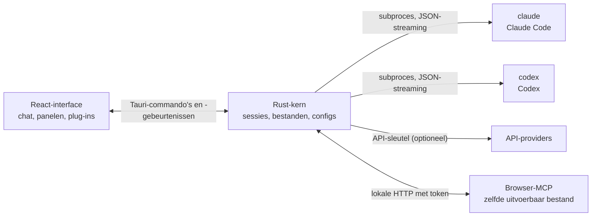

<p align="center">
  
</p>

<h1 align="center">LunaHarness</h1>

<p align="center">
  <a href="README.md">Português (Brasil)</a> · <a href="README.en.md">English</a> · <a href="README.es.md">Español</a> · <a href="README.fr.md">Français</a> · <a href="README.de.md">Deutsch</a> · <a href="README.it.md">Italiano</a> · <strong>Nederlands</strong> · <a href="README.pl.md">Polski</a> · <a href="README.sv.md">Svenska</a> · <a href="README.ru.md">Русский</a> · <a href="README.uk.md">Українська</a> · <a href="README.tr.md">Türkçe</a> · <a href="README.ar.md">العربية</a> · <a href="README.he.md">עברית</a> · <a href="README.hi.md">हिन्दी</a> · <a href="README.id.md">Bahasa Indonesia</a> · <a href="README.vi.md">Tiếng Việt</a> · <a href="README.th.md">ไทย</a> · <a href="README.ja.md">日本語</a> · <a href="README.ko.md">한국어</a> · <a href="README.zh-CN.md">简体中文</a> · <a href="README.zh-TW.md">繁體中文</a>
</p>

<p align="center">
  Een desktopapp om in één venster met <strong>Claude Code</strong> en <strong>Codex</strong> te werken, met plug-ins, skills, MCP-servers en een browser die de agent kan gebruiken.
</p>

---

## Wat is het

LunaHarness is geen AI-model. Het is een **schil** rond de officiële CLI's die je al gebruikt: `claude` (Claude Code) en `codex` (Codex). De app start die tools, gebruikt de login die je er al hebt gedaan en toont het gesprek in een chatvenster, met daarnaast wat de agent doet: bestandswijzigingen, plan, voortgang en een terminal.

Het doel is één plek om met de agent te werken, zonder te verliezen wat de CLI's bieden:

- Provider, model, inspanning en machtigingsmodus wisselen zonder het gesprek opnieuw te starten.
- De diff van wat de agent heeft gewijzigd bekijken, wijzigingen ongedaan maken en teruggaan naar een eerder punt.
- Skills, MCP-servers en plug-ins één keer installeren en in beide CLI's gebruiken.
- De agent een eigen browser geven om pagina's te lezen en ermee te werken.

## Functies

**Gesprek**
- Chat met streaming, bijlagen (afbeeldingen en bestanden) en een `/`-menu met Luna-commando's, skills en CLI-commando's.
- Planmodus: het volledige plan gaat naar het paneel **Plan**, en de chatbel toont alleen een samenvatting.
- Contextcompactie, handmatig (`/compactar`) of automatisch vlak voor de limiet.
- Globale regels: de tekst die je schrijft gaat naar het `CLAUDE.md` en het `AGENTS.md` van beide CLI's.

**Zijpaneel**
- **Wijzigingen:** lijst met gewijzigde bestanden, met diff en ongedaan maken.
- **Plan** en **Voortgang:** het plan van de agent en de taakstappen, in volgorde.
- **Terminal:** een shell in de projectmap (`Ctrl + `` `).
- **Browser:** een ingebedde pagina die de agent ook kan besturen (zie [Huidige status](#huidige-status)).

**Uitbreidingen**
- **Skills** en **MCP-servers** uit officiële catalogi of via een URL, geïnstalleerd in de globale configuratie van beide CLI's.
- **Plug-ins** die gedrag aan de chat toevoegen: panelen in de zijbalk, commando's en meldingen. Een standaardplug-in, **Cache de Tokens**, toont hoeveel van de prompt uit de cache van de provider is hergebruikt.
- MCP-geheimen blijven in de omgevingsvariabelen van je gebruiker. De app slaat de waarde nooit op en toont die niet.

**Uiterlijk**
- Lichte en donkere thema's, met optioneel glaseffect.
- Optionele antwoordgeluiden en meldingen wanneer het venster niet actief is.

## Hoe het werkt



- Elke CLI heeft een **adapter** die zijn JSON-uitvoer vertaalt naar interne gebeurtenissen. De frontend leest nooit het ruwe formaat.
- De app bewaart je CLI-inloggegevens niet: het officiële binaire bestand regelt de login.
- API-sleutels zijn optioneel, per profiel, en worden opgeslagen in de beveiligde opslag van het systeem.

## Vereisten

- **Windows 10 of 11** (het project is nu voorbereid op Windows; de buildscripts gebruiken MSVC).
- **Node.js** LTS en **npm**.
- **Rust** (`stable`-toolchain, `x86_64-pc-windows-msvc`) en de C++-buildtools van Visual Studio.
- Ten minste één CLI geïnstalleerd en ingelogd: Claude Code en/of Codex.

## Installeren en starten

```bash
git clone https://github.com/GuilhermeFelix95/LunaHarnes.git
cd LunaHarnes
npm install
```

Om de app in ontwikkelmodus te openen:

```bash
npm run dev:app
```

Om het uitvoerbare bestand te bouwen:

```bash
npm run build:app
```

Om alleen de interface in de browser te draaien (zonder Rust-kern, dus zonder CLI's):

```bash
npm run dev
```

## Tests

```bash
npm test                 # frontend (Vitest + Testing Library)
npm run test:rust        # Rust-kern (cargo test)
```

Als je een module wijzigt, draai de tests daarvan; de volledige suite is er wanneer je erom vraagt.

## Structuur

```
src/                 React- + TypeScript-interface (chat, panelen, plug-ins)
src-tauri/src/       Rust-kern (providers, sessies, bestanden, MCP, plug-ins, browser)
src-tauri/marketplace/  ingebouwde officiële catalogi (skills, MCP, plug-ins), met sha256
plugins-examples/    referentieplug-ins
bin/                 `luna`-commando (installeert skills, MCP en plug-ins vanuit de terminal)
docs/                handleidingen: stack, plug-ins, skills, MCP
spec/                functiespecificaties (promptcache, antwoordcache)
```

## Documentatie

- [`docs/stack.md`](docs/stack.md): stack, architectuur, projectregels en wijzigingen.
- [`docs/plugins.md`](docs/plugins.md): hoe je plug-ins maakt (ook door Luna zelf gelezen).
- [`docs/skills.md`](docs/skills.md): hoe skills werken.
- [`docs/mcp.md`](docs/mcp.md): MCP-servers en hoe geheimen worden behandeld.
- [`docs/motor-proprio.md`](docs/motor-proprio.md): studie over een eigen engine en gebruiksregels voor abonnementen.
- [`spec/cache-de-prompt.md`](spec/cache-de-prompt.md): hoe de app de cache van de provider meet.

## Huidige status

Werkt en is getest:

- Gesprek met Claude Code en Codex, planning, voortgang, compactie en diff.
- Skills, MCP-servers en plug-ins geïnstalleerd vanuit de app of het `luna`-commando.
- Promptcache per beurt gemeten, met de plug-in Cache de Tokens.
- Geïntegreerde terminal en worktrees per branch.

In ontwikkeling, nog niet end-to-end gecontroleerd in de app:

- **Geïntegreerde browser:** de pagina verschijnt in een webview binnen het venster, en Claude krijgt de tools navigeren, lezen, klikken en typen. Hij gebruikt een `unstable`-functie van Tauri. Codex krijgt deze tools nog niet.

## Bijdragen

De handleidingen in `docs/` leggen de standaarden van het project uit. Gedragswijzigingen komen met tests, en `docs/stack.md` en `MEMORY.md` worden samen met de code bijgewerkt.
