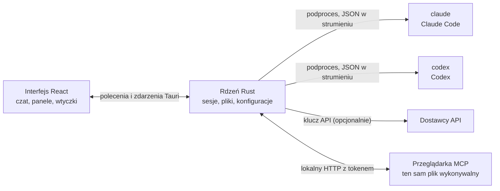

<p align="center">
  
</p>

<h1 align="center">LunaHarness</h1>

<p align="center">
  <a href="README.md">Português (Brasil)</a> · <a href="README.en.md">English</a> · <a href="README.es.md">Español</a> · <a href="README.fr.md">Français</a> · <a href="README.de.md">Deutsch</a> · <a href="README.it.md">Italiano</a> · <a href="README.nl.md">Nederlands</a> · <strong>Polski</strong> · <a href="README.sv.md">Svenska</a> · <a href="README.ru.md">Русский</a> · <a href="README.uk.md">Українська</a> · <a href="README.tr.md">Türkçe</a> · <a href="README.ar.md">العربية</a> · <a href="README.he.md">עברית</a> · <a href="README.hi.md">हिन्दी</a> · <a href="README.id.md">Bahasa Indonesia</a> · <a href="README.vi.md">Tiếng Việt</a> · <a href="README.th.md">ไทย</a> · <a href="README.ja.md">日本語</a> · <a href="README.ko.md">한국어</a> · <a href="README.zh-CN.md">简体中文</a> · <a href="README.zh-TW.md">繁體中文</a>
</p>

<p align="center">
  Aplikacja desktopowa do rozmów z <strong>Claude Code</strong> i <strong>Codex</strong> w jednym oknie, z wtyczkami, skillami, serwerami MCP i przeglądarką, z której może korzystać agent.
</p>

---

## Czym jest

LunaHarness nie jest modelem AI. To **powłoka** wokół oficjalnych CLI, których już używasz: `claude` (Claude Code) i `codex` (Codex). Aplikacja uruchamia te narzędzia, korzysta z logowania, które już w nich wykonałeś, i pokazuje rozmowę w oknie czatu, obok tego, co robi agent: zmiany w plikach, plan, postęp i terminal.

Celem jest jedno miejsce do pracy z agentem, bez utraty tego, co oferują CLI:

- Zmiana dostawcy, modelu, poziomu wysiłku i trybu uprawnień bez restartu rozmowy.
- Podgląd różnic (diff) zmian agenta, cofanie zmian i powrót do wcześniejszego stanu.
- Jednorazowa instalacja skilli, serwerów MCP i wtyczek, z użyciem w obu CLI.
- Dać agentowi własną przeglądarkę do czytania stron i interakcji z nimi.

## Funkcje

**Rozmowa**
- Czat ze strumieniowaniem, załącznikami (obrazy i pliki) oraz menu `/` z poleceniami Luny, skillami i poleceniami CLI.
- Tryb planowania: pełny plan trafia do panelu **Plan**, a dymek czatu pokazuje tylko podsumowanie.
- Kompaktowanie kontekstu, ręcznie (`/compactar`) lub automatycznie przy limicie.
- Reguły globalne: tekst, który napiszesz, trafia do `CLAUDE.md` i `AGENTS.md` obu CLI.

**Panel boczny**
- **Zmiany:** lista zmienionych plików, z diffem i cofaniem.
- **Plan** i **Postęp:** plan agenta i kroki zadania, w kolejności.
- **Terminal:** powłoka w folderze projektu (`Ctrl + `` `).
- **Przeglądarka:** osadzona strona, którą agent też może sterować (zob. [Stan obecny](#stan-obecny)).

**Rozszerzenia**
- **Skille** i **serwery MCP** z oficjalnych katalogów lub z adresu URL, zainstalowane w globalnej konfiguracji obu CLI.
- **Wtyczki**, które dodają zachowania do czatu: panele w pasku bocznym, polecenia i powiadomienia. Domyślna wtyczka, **Cache de Tokens**, pokazuje, ile promptu zostało ponownie użyte z pamięci podręcznej dostawcy.
- Sekrety MCP pozostają w zmiennych środowiskowych użytkownika. Aplikacja nigdy nie zapisuje ani nie pokazuje wartości.

**Wygląd**
- Jasny i ciemny motyw, z opcjonalnym efektem szkła.
- Opcjonalne dźwięki odpowiedzi i powiadomienia, gdy okno nie ma fokusa.

## Jak to działa



- Każde CLI ma **adapter**, który tłumaczy jego wyjście JSON na zdarzenia wewnętrzne. Frontend nigdy nie czyta surowego formatu.
- Aplikacja nie przechowuje danych logowania do CLI: logowanie obsługuje oficjalny plik binarny.
- Klucze API są opcjonalne, dla każdego profilu, i zapisywane w bezpiecznym magazynie systemu.

## Pobieranie

- Gdy zostanie opublikowana wersja, instalator dla Windows będzie na [stronie wydań](https://github.com/GuilhermeFelix95/lunaCode/releases).
- Wymagania: Windows 10 (wersja 1809 lub nowsza) lub Windows 11 oraz co najmniej jedno zainstalowane i zalogowane CLI (`claude` lub `codex`). Node.js i Rust nie są potrzebne.
- Instalator nie ma jeszcze podpisu kodu, więc Windows może pokazać ostrzeżenie SmartScreen. Wybierz „Więcej informacji”, a potem „Uruchom mimo to”.

## Wymagania

- **Windows 10 lub 11** (projekt jest obecnie przygotowany pod Windows; skrypty budowania używają MSVC).
- **Node.js** LTS i **npm**.
- **Rust** (toolchain `stable`, `x86_64-pc-windows-msvc`) oraz narzędzia budowania C++ z Visual Studio.
- Co najmniej jedno CLI zainstalowane i zalogowane: Claude Code i/lub Codex.

## Instalacja i uruchomienie

```bash
git clone https://github.com/GuilhermeFelix95/lunaCode.git
cd LunaHarnes
npm install
```

Aby otworzyć aplikację w trybie deweloperskim:

```bash
npm run dev:app
```

Aby zbudować plik wykonywalny:

```bash
npm run build:app
```

Aby uruchomić tylko interfejs w przeglądarce (bez rdzenia Rust, więc bez CLI):

```bash
npm run dev
```

## Testy

```bash
npm test                 # frontend (Vitest + Testing Library)
npm run test:rust        # rdzeń Rust (cargo test)
```

Po zmianie modułu uruchom jego testy; pełny zestaw służy wtedy, gdy o niego poprosisz.

## Struktura

```
src/                 interfejs React + TypeScript (czat, panele, wtyczki)
src-tauri/src/       rdzeń Rust (dostawcy, sesje, pliki, MCP, wtyczki, przeglądarka)
src-tauri/marketplace/  wbudowane oficjalne katalogi (skille, MCP, wtyczki), z sha256
plugins-examples/    wtyczki referencyjne
bin/                 polecenie `luna` (instaluje skille, MCP i wtyczki z terminala)
docs/                przewodniki: stack, wtyczki, skille, MCP
spec/                specyfikacje funkcji (cache promptu, cache odpowiedzi)
```

## Dokumentacja

- [`docs/stack.md`](docs/stack.md): stack, architektura, zasady projektu i zmiany.
- [`docs/plugins.md`](docs/plugins.md): jak tworzyć wtyczki (czyta go także sama Luna).
- [`docs/skills.md`](docs/skills.md): jak działają skille.
- [`docs/mcp.md`](docs/mcp.md): serwery MCP i postępowanie z sekretami.
- [`docs/motor-proprio.md`](docs/motor-proprio.md): analiza własnego silnika i zasady korzystania z subskrypcji.
- [`spec/cache-de-prompt.md`](spec/cache-de-prompt.md): jak aplikacja mierzy cache dostawcy.

## Stan obecny

Działa i jest przetestowane:

- Rozmowa z Claude Code i Codex, planowanie, postęp, kompaktowanie i diff.
- Skille, serwery MCP i wtyczki zainstalowane z aplikacji lub poleceniem `luna`.
- Cache promptu mierzony dla każdej tury, z wtyczką Cache de Tokens.
- Zintegrowany terminal i worktrees dla gałęzi.

W trakcie rozwoju, jeszcze nie sprawdzone end-to-end w aplikacji:

- **Zintegrowana przeglądarka:** strona pojawia się w webview wewnątrz okna, a Claude dostaje narzędzia do nawigacji, czytania, klikania i wpisywania. Używa funkcji `unstable` Tauri. Codex jeszcze nie dostaje tych narzędzi.

## Współtworzenie

Przewodniki w `docs/` opisują standardy projektu. Zmiany zachowania idą z testami, a `docs/stack.md` i `MEMORY.md` są aktualizowane razem z kodem.
