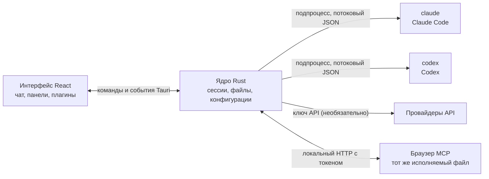

<p align="center">
  
</p>

<h1 align="center">LunaHarness</h1>

<p align="center">
  <a href="README.md">Português (Brasil)</a> · <a href="README.en.md">English</a> · <a href="README.es.md">Español</a> · <a href="README.fr.md">Français</a> · <a href="README.de.md">Deutsch</a> · <a href="README.it.md">Italiano</a> · <a href="README.nl.md">Nederlands</a> · <a href="README.pl.md">Polski</a> · <a href="README.sv.md">Svenska</a> · <strong>Русский</strong> · <a href="README.uk.md">Українська</a> · <a href="README.tr.md">Türkçe</a> · <a href="README.ar.md">العربية</a> · <a href="README.he.md">עברית</a> · <a href="README.hi.md">हिन्दी</a> · <a href="README.id.md">Bahasa Indonesia</a> · <a href="README.vi.md">Tiếng Việt</a> · <a href="README.th.md">ไทย</a> · <a href="README.ja.md">日本語</a> · <a href="README.ko.md">한국어</a> · <a href="README.zh-CN.md">简体中文</a> · <a href="README.zh-TW.md">繁體中文</a>
</p>

<p align="center">
  Настольное приложение для работы с <strong>Claude Code</strong> и <strong>Codex</strong> в одном окне: с плагинами, скиллами, серверами MCP и браузером, которым может пользоваться агент.
</p>

---

## Что это

LunaHarness — не модель ИИ. Это **оболочка** вокруг официальных CLI, которые вы уже используете: `claude` (Claude Code) и `codex` (Codex). Приложение запускает эти инструменты, использует вход, который вы уже выполнили в них, и показывает разговор в окне чата, а рядом — что делает агент: изменения файлов, план, прогресс и терминал.

Цель — одно место для работы с агентом без потери возможностей CLI:

- Смена провайдера, модели, уровня усилия и режима разрешений без перезапуска разговора.
- Просмотр diff изменений агента, отмена правок и возврат к более раннему состоянию.
- Установка скиллов, серверов MCP и плагинов один раз с использованием в обеих CLI.
- Собственный браузер для агента: чтение страниц и взаимодействие с ними.

## Возможности

**Разговор**
- Чат с потоковым выводом, вложениями (изображения и файлы) и меню `/` с командами Луны, скиллами и командами CLI.
- Режим планирования: полный план попадает на панель **План**, а пузырь чата показывает только краткое содержание.
- Сжатие контекста — вручную (`/compactar`) или автоматически у предела.
- Глобальные правила: текст, который вы пишете, попадает в `CLAUDE.md` и `AGENTS.md` обеих CLI.

**Боковая панель**
- **Изменения:** список изменённых файлов с diff и отменой.
- **План** и **Прогресс:** план агента и шаги задачи по порядку.
- **Терминал:** оболочка в папке проекта (`Ctrl + `` `).
- **Браузер:** встроенная страница, которой может управлять и агент (см. [Текущее состояние](#текущее-состояние)).

**Расширения**
- **Скиллы** и **серверы MCP** из официальных каталогов или по URL, установленные в глобальную конфигурацию обеих CLI.
- **Плагины**, которые добавляют в чат поведение: панели в боковой колонке, команды и уведомления. Плагин по умолчанию, **Cache de Tokens**, показывает, какая часть промпта повторно использована из кэша провайдера.
- Секреты MCP остаются в переменных окружения пользователя. Приложение никогда не хранит и не показывает значение.

**Оформление**
- Светлая и тёмная темы, с необязательным эффектом стекла.
- Необязательные звуки ответа и уведомления, когда окно не в фокусе.

## Как это работает



- У каждой CLI есть **адаптер**, который переводит её JSON-вывод во внутренние события. Интерфейс никогда не читает исходный формат.
- Приложение не хранит ваши учётные данные CLI: вход обрабатывает официальный исполняемый файл.
- Ключи API необязательны, задаются для каждого профиля и хранятся в защищённом хранилище системы.

## Скачать

- Когда будет опубликована версия, установщик для Windows появится на [странице релизов](https://github.com/GuilhermeFelix95/LunaHarnes/releases).
- Требования: Windows 10 (версия 1809 или новее) или Windows 11 и хотя бы один установленный и авторизованный CLI (`claude` или `codex`). Node.js и Rust не нужны.
- Установщик пока не подписан, поэтому Windows может показать предупреждение SmartScreen. Выберите «Подробнее», а затем «Выполнить в любом случае».

## Требования

- **Windows 10 или 11** (проект сейчас подготовлен для Windows; скрипты сборки используют MSVC).
- **Node.js** LTS и **npm**.
- **Rust** (тулчейн `stable`, `x86_64-pc-windows-msvc`) и инструменты сборки C++ из Visual Studio.
- Установлена и выполнен вход хотя бы в одну CLI: Claude Code и/или Codex.

## Установка и запуск

```bash
git clone https://github.com/GuilhermeFelix95/LunaHarnes.git
cd LunaHarnes
npm install
```

Чтобы открыть приложение в режиме разработки:

```bash
npm run dev:app
```

Чтобы собрать исполняемый файл:

```bash
npm run build:app
```

Чтобы запустить только интерфейс в браузере (без ядра Rust, то есть без CLI):

```bash
npm run dev
```

## Тесты

```bash
npm test                 # фронтенд (Vitest + Testing Library)
npm run test:rust        # ядро Rust (cargo test)
```

После изменения модуля запускайте его тесты; полный набор нужен, когда вы его запрашиваете.

## Структура

```
src/                 интерфейс React + TypeScript (чат, панели, плагины)
src-tauri/src/       ядро Rust (провайдеры, сессии, файлы, MCP, плагины, браузер)
src-tauri/marketplace/  встроенные официальные каталоги (скиллы, MCP, плагины), с sha256
plugins-examples/    эталонные плагины
bin/                 команда `luna` (устанавливает скиллы, MCP и плагины из терминала)
docs/                руководства: стек, плагины, скиллы, MCP
spec/                спецификации функций (кэш промпта, кэш ответов)
```

## Документация

- [`docs/stack.md`](docs/stack.md): стек, архитектура, правила проекта и изменения.
- [`docs/plugins.md`](docs/plugins.md): как создавать плагины (это руководство читает и сама Луна).
- [`docs/skills.md`](docs/skills.md): как работают скиллы.
- [`docs/mcp.md`](docs/mcp.md): серверы MCP и работа с секретами.
- [`docs/motor-proprio.md`](docs/motor-proprio.md): обзор собственного движка и правил использования подписок.
- [`spec/cache-de-prompt.md`](spec/cache-de-prompt.md): как приложение измеряет кэш провайдера.

## Текущее состояние

Работает и протестировано:

- Разговор с Claude Code и Codex, планирование, прогресс, сжатие и diff.
- Скиллы, серверы MCP и плагины, установленные из приложения или командой `luna`.
- Кэш промпта, измеряемый на каждом ходе, с плагином Cache de Tokens.
- Встроенный терминал и worktree по веткам.

В разработке, ещё не проверено сквозным образом в приложении:

- **Встроенный браузер:** страница появляется в webview внутри окна, а Claude получает инструменты для навигации, чтения, нажатия и ввода. Используется функция `unstable` Tauri. Codex пока эти инструменты не получает.

## Участие в проекте

Руководства в `docs/` объясняют стандарты проекта. Изменения поведения сопровождаются тестами, а `docs/stack.md` и `MEMORY.md` обновляются вместе с кодом.
