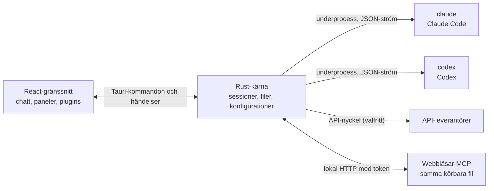

<p align="center">
  
</p>

<h1 align="center">LunaHarness</h1>

<p align="center">
  <a href="README.md">Português (Brasil)</a> · <a href="README.en.md">English</a> · <a href="README.es.md">Español</a> · <a href="README.fr.md">Français</a> · <a href="README.de.md">Deutsch</a> · <a href="README.it.md">Italiano</a> · <a href="README.nl.md">Nederlands</a> · <a href="README.pl.md">Polski</a> · <strong>Svenska</strong> · <a href="README.ru.md">Русский</a> · <a href="README.uk.md">Українська</a> · <a href="README.tr.md">Türkçe</a> · <a href="README.ar.md">العربية</a> · <a href="README.he.md">עברית</a> · <a href="README.hi.md">हिन्दी</a> · <a href="README.id.md">Bahasa Indonesia</a> · <a href="README.vi.md">Tiếng Việt</a> · <a href="README.th.md">ไทย</a> · <a href="README.ja.md">日本語</a> · <a href="README.ko.md">한국어</a> · <a href="README.zh-CN.md">简体中文</a> · <a href="README.zh-TW.md">繁體中文</a>
</p>

<p align="center">
  Ett skrivbordsprogram för att prata med <strong>Claude Code</strong> och <strong>Codex</strong> i ett fönster, med plugins, skills, MCP-servrar och en webbläsare som agenten kan använda.
</p>

---

## Vad är det

LunaHarness är inte en AI-modell. Det är ett **skal** runt de officiella CLI:erna du redan använder: `claude` (Claude Code) och `codex` (Codex). Appen startar dessa verktyg, använder inloggningen du redan gjort i dem och visar konversationen i ett chattfönster, med det agenten gör bredvid: filändringar, plan, framsteg och en terminal.

Målet är ett enda ställe för att arbeta med agenten, utan att förlora det CLI:erna erbjuder:

- Byta leverantör, modell, ansträngning och behörighetsläge utan att starta om konversationen.
- Se diffen för agentens ändringar, ångra ändringar och gå tillbaka till en tidigare punkt.
- Installera skills, MCP-servrar och plugins en gång och använda dem i båda CLI:erna.
- Ge agenten en egen webbläsare för att läsa sidor och interagera med dem.

## Funktioner

**Konversation**
- Chatt med strömning, bild- och filbilagor och en `/`-meny med Luna-kommandon, skills och CLI-kommandon.
- Planeringsläge: hela planen går till panelen **Plan**, och chattbubblan visar bara en sammanfattning.
- Kontextkomprimering, manuellt (`/compactar`) eller automatiskt nära gränsen.
- Globala regler: texten du skriver hamnar i `CLAUDE.md` och `AGENTS.md` för båda CLI:erna.

**Sidopanel**
- **Ändringar:** lista över ändrade filer, med diff och ångra.
- **Plan** och **Framsteg:** agentens plan och uppgiftens steg, i ordning.
- **Terminal:** ett skal i projektmappen (`Ctrl + `` `).
- **Webbläsare:** en inbäddad sida som agenten också kan styra (se [Nuläge](#nulage)).

**Tillägg**
- **Skills** och **MCP-servrar** från officiella kataloger eller via en URL, installerade i den globala konfigurationen för båda CLI:erna.
- **Plugins** som lägger till beteenden i chatten: paneler i sidofältet, kommandon och aviseringar. En standardplugin, **Cache de Tokens**, visar hur mycket av prompten som återanvänts från leverantörens cache.
- MCP-hemligheter ligger kvar i din användares miljövariabler. Appen sparar eller visar aldrig värdet.

**Utseende**
- Ljust och mörkt tema, med valfri glaseffekt.
- Valfria svarsljud och aviseringar när fönstret inte är i fokus.

## Så fungerar det



- Varje CLI har en **adapter** som översätter dess JSON-utdata till interna händelser. Gränssnittet läser aldrig det råa formatet.
- Appen sparar inte dina CLI-uppgifter: den officiella binärfilen sköter inloggningen.
- API-nycklar är valfria, per profil, och lagras i systemets säkra lagring.

## Ladda ner

- När en version har publicerats finns Windows-installeraren på [releasesidan](https://github.com/GuilhermeFelix95/LunaHarnes/releases).
- Krav: Windows 10 (version 1809 eller senare) eller Windows 11, och minst ett installerat och inloggat CLI (`claude` eller `codex`). Node.js och Rust behövs inte.
- Installeraren är ännu inte kodsignerad, så Windows kan visa en SmartScreen-varning. Välj "Mer information" och sedan "Kör ändå".

## Krav

- **Windows 10 eller 11** (projektet är för närvarande förberett för Windows; byggskripten använder MSVC).
- **Node.js** LTS och **npm**.
- **Rust** (`stable`-verktygskedjan, `x86_64-pc-windows-msvc`) och C++-byggverktygen från Visual Studio.
- Minst en CLI installerad och inloggad: Claude Code och/eller Codex.

## Installation och körning

```bash
git clone https://github.com/GuilhermeFelix95/LunaHarnes.git
cd LunaHarnes
npm install
```

För att öppna appen i utvecklingsläge:

```bash
npm run dev:app
```

För att bygga den körbara filen:

```bash
npm run build:app
```

För att bara köra gränssnittet i webbläsaren (utan Rust-kärnan, alltså utan CLI:er):

```bash
npm run dev
```

## Tester

```bash
npm test                 # frontend (Vitest + Testing Library)
npm run test:rust        # Rust-kärnan (cargo test)
```

När du ändrar en modul kör du dess tester; hela sviten används när du begär den.

## Struktur

```
src/                 React- och TypeScript-gränssnitt (chatt, paneler, plugins)
src-tauri/src/       Rust-kärna (leverantörer, sessioner, filer, MCP, plugins, webbläsare)
src-tauri/marketplace/  inbyggda officiella kataloger (skills, MCP, plugins), med sha256
plugins-examples/    referensplugins
bin/                 kommandot `luna` (installerar skills, MCP och plugins från terminalen)
docs/                guider: stack, plugins, skills, MCP
spec/                funktionsspecifikationer (promptcache, svarscache)
```

## Dokumentation

- [`docs/stack.md`](docs/stack.md): stack, arkitektur, projektregler och ändringar.
- [`docs/plugins.md`](docs/plugins.md): hur du skapar plugins (läses även av Luna själv).
- [`docs/skills.md`](docs/skills.md): hur skills fungerar.
- [`docs/mcp.md`](docs/mcp.md): MCP-servrar och hur hemligheter hanteras.
- [`docs/motor-proprio.md`](docs/motor-proprio.md): studie om en egen motor och regler för användning av prenumerationer.
- [`spec/cache-de-prompt.md`](spec/cache-de-prompt.md): hur appen mäter leverantörens cache.

<a id="nulage"></a>
## Nuläge

Fungerar och är testat:

- Konversation med Claude Code och Codex, planering, framsteg, komprimering och diff.
- Skills, MCP-servrar och plugins installerade från appen eller kommandot `luna`.
- Promptcache mätt per tur, med plugin-programmet Cache de Tokens.
- Integrerad terminal och worktrees per gren.

Under utveckling, ännu inte verifierat från början till slut i appen:

- **Integrerad webbläsare:** sidan visas i en webview inuti fönstret, och Claude får verktygen navigera, läsa, klicka och skriva. Den använder en `unstable`-funktion i Tauri. Codex får ännu inte dessa verktyg.

## Bidra

Guiderna i `docs/` förklarar projektets standarder. Beteendeändringar kommer med tester, och `docs/stack.md` och `MEMORY.md` uppdateras tillsammans med koden.
