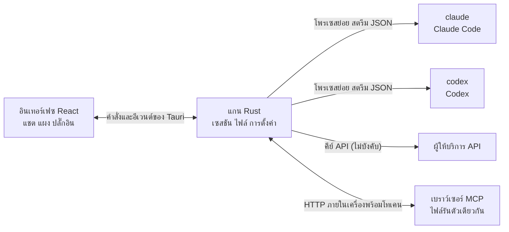

<p align="center">
  
</p>

<h1 align="center">LunaHarness</h1>

<p align="center">
  <a href="README.md">Português (Brasil)</a> · <a href="README.en.md">English</a> · <a href="README.es.md">Español</a> · <a href="README.fr.md">Français</a> · <a href="README.de.md">Deutsch</a> · <a href="README.it.md">Italiano</a> · <a href="README.nl.md">Nederlands</a> · <a href="README.pl.md">Polski</a> · <a href="README.sv.md">Svenska</a> · <a href="README.ru.md">Русский</a> · <a href="README.uk.md">Українська</a> · <a href="README.tr.md">Türkçe</a> · <a href="README.ar.md">العربية</a> · <a href="README.he.md">עברית</a> · <a href="README.hi.md">हिन्दी</a> · <a href="README.id.md">Bahasa Indonesia</a> · <a href="README.vi.md">Tiếng Việt</a> · <strong>ไทย</strong> · <a href="README.ja.md">日本語</a> · <a href="README.ko.md">한국어</a> · <a href="README.zh-CN.md">简体中文</a> · <a href="README.zh-TW.md">繁體中文</a>
</p>

<p align="center">
  แอปเดสก์ท็อปสำหรับพูดคุยกับ <strong>Claude Code</strong> และ <strong>Codex</strong> ในหน้าต่างเดียว พร้อมปลั๊กอิน skill เซิร์ฟเวอร์ MCP และเบราว์เซอร์ที่เอเจนต์ใช้งานได้
</p>

---

## นี่คืออะไร

LunaHarness ไม่ใช่โมเดล AI แต่เป็น **เปลือก** ที่หุ้มซีแอลไอทางการที่คุณใช้อยู่แล้ว ได้แก่ `claude` (Claude Code) และ `codex` (Codex) แอปจะเรียกใช้เครื่องมือเหล่านั้น ใช้การเข้าสู่ระบบที่คุณทำไว้แล้วในแต่ละตัว และแสดงการสนทนาในหน้าต่างแชต พร้อมสิ่งที่เอเจนต์กำลังทำอยู่ข้างๆ ได้แก่ การเปลี่ยนแปลงไฟล์ แผน ความคืบหน้า และเทอร์มินัล

เป้าหมายคือมีที่เดียวสำหรับทำงานกับเอเจนต์ โดยไม่สูญเสียสิ่งที่ซีแอลไอนำเสนอ:

- สลับผู้ให้บริการ โมเดล ระดับความพยายาม และโหมดสิทธิ์ได้โดยไม่ต้องเริ่มการสนทนาใหม่
- ดูความต่าง (diff) ของการเปลี่ยนแปลงที่เอเจนต์ทำ ย้อนการเปลี่ยนแปลง และกลับไปยังจุดก่อนหน้าได้
- ติดตั้ง skill เซิร์ฟเวอร์ MCP และปลั๊กอินเพียงครั้งเดียว แล้วใช้ได้ในซีแอลไอทั้งสองตัว
- มอบเบราว์เซอร์ของตัวเองให้เอเจนต์ สำหรับอ่านหน้าเว็บและโต้ตอบกับหน้าเว็บนั้น

## ฟีเจอร์

**การสนทนา**
- แชตแบบสตรีมมิง พร้อมไฟล์แนบเป็นรูปภาพและไฟล์ และเมนู `/` ที่มีคำสั่งของลูน่า skill และคำสั่งของซีแอลไอ
- โหมดวางแผน: แผนฉบับเต็มจะไปอยู่ในแผง **แผน** ส่วนบับเบิลแชตจะแสดงเฉพาะสรุป
- การบีบอัดบริบท ทั้งแบบกดเอง (`/compactar`) หรืออัตโนมัติเมื่อใกล้ถึงขีดจำกัด
- กฎส่วนกลาง: ข้อความที่คุณเขียนจะถูกใส่ไว้ใน `CLAUDE.md` และ `AGENTS.md` ของซีแอลไอทั้งสองตัว

**แผงด้านข้าง**
- **การเปลี่ยนแปลง:** รายการไฟล์ที่ถูกแก้ไข พร้อม diff และการย้อนกลับ
- **แผน** และ **ความคืบหน้า:** แผนของเอเจนต์และขั้นตอนของงานตามลำดับ
- **เทอร์มินัล:** เชลล์ในโฟลเดอร์โปรเจกต์ (`Ctrl + `` `)
- **เบราว์เซอร์:** หน้าเว็บแบบฝังที่เอเจนต์ก็ควบคุมได้ (ดู [สถานะปัจจุบัน](#สถานะปัจจุบัน))

**ส่วนขยาย**
- **Skill** และ **เซิร์ฟเวอร์ MCP** จากแคตตาล็อกทางการหรือผ่าน URL ติดตั้งลงในการตั้งค่าส่วนกลางของซีแอลไอทั้งสองตัว
- **ปลั๊กอิน** ที่เพิ่มพฤติกรรมให้แชต ได้แก่ แผงในแถบด้านข้าง คำสั่ง และการแจ้งเตือน ปลั๊กอินตั้งต้น **Cache de Tokens** แสดงว่าส่วนของพรอมต์ถูกนำกลับมาใช้จากแคชของผู้ให้บริการเท่าไร
- ความลับของ MCP จะอยู่ในตัวแปรสภาพแวดล้อมของผู้ใช้ แอปไม่เคยบันทึกหรือแสดงค่านั้น

**รูปลักษณ์**
- ธีมสว่างและมืด พร้อมเอฟเฟกต์กระจกแบบเลือกได้
- เสียงตอบกลับและการแจ้งเตือนแบบเลือกได้ เมื่อหน้าต่างไม่ได้อยู่ในโฟกัส

## การทำงาน



- ซีแอลไอแต่ละตัวมี **อะแดปเตอร์** ที่แปลผลลัพธ์ JSON ให้เป็นอีเวนต์ภายใน อินเทอร์เฟซจะไม่อ่านรูปแบบดิบเลย
- แอปไม่เก็บข้อมูลประจำตัวซีแอลไอของคุณ ไฟล์ไบนารีทางการเป็นผู้จัดการการเข้าสู่ระบบ
- คีย์ API เป็นตัวเลือก กำหนดต่อโปรไฟล์ และเก็บไว้ในที่เก็บที่ปลอดภัยของระบบ

## ดาวน์โหลด

- เมื่อมีการเผยแพร่เวอร์ชัน ตัวติดตั้งสำหรับ Windows จะอยู่ที่[หน้า releases](https://github.com/GuilhermeFelix95/lunaCode/releases)
- ความต้องการ: Windows 10 (เวอร์ชัน 1809 ขึ้นไป) หรือ Windows 11 และมี CLI อย่างน้อยหนึ่งตัวที่ติดตั้งและล็อกอินแล้ว (`claude` หรือ `codex`) ไม่ต้องใช้ Node.js หรือ Rust
- ตัวติดตั้งยังไม่มีลายเซ็นของโค้ด Windows จึงอาจแสดงคำเตือนของ SmartScreen เลือก "More info" แล้วเลือก "Run anyway"

## ความต้องการของระบบ

- **Windows 10 หรือ 11** (โปรเจกต์นี้เตรียมไว้สำหรับ Windows ในปัจจุบัน สคริปต์การบิลด์ใช้ MSVC)
- **Node.js** รุ่น LTS และ **npm**
- **Rust** (toolchain `stable`, `x86_64-pc-windows-msvc`) และเครื่องมือบิลด์ C++ ของ Visual Studio
- มีซีแอลไออย่างน้อยหนึ่งตัวติดตั้งและเข้าสู่ระบบแล้ว: Claude Code และ/หรือ Codex

## การติดตั้งและการรัน

```bash
git clone https://github.com/GuilhermeFelix95/lunaCode.git
cd LunaHarnes
npm install
```

เพื่อเปิดแอปในโหมดพัฒนา:

```bash
npm run dev:app
```

เพื่อบิลด์ไฟล์รัน:

```bash
npm run build:app
```

เพื่อรันเฉพาะอินเทอร์เฟซในเบราว์เซอร์ (ไม่มีแกน Rust จึงไม่มีซีแอลไอ):

```bash
npm run dev
```

## การทดสอบ

```bash
npm test                 # ฟรอนต์เอนด์ (Vitest + Testing Library)
npm run test:rust        # แกน Rust (cargo test)
```

เมื่อแก้ไขโมดูลใด ให้รันการทดสอบของโมดูลนั้น ส่วนชุดทดสอบทั้งหมดจะรันเมื่อคุณขอ

## โครงสร้าง

```
src/                 อินเทอร์เฟซ React + TypeScript (แชต แผง ปลั๊กอิน)
src-tauri/src/       แกน Rust (ผู้ให้บริการ เซสชัน ไฟล์ MCP ปลั๊กอิน เบราว์เซอร์)
src-tauri/marketplace/  แคตตาล็อกทางการที่ฝังมา (skill, MCP, ปลั๊กอิน) พร้อม sha256
plugins-examples/    ปลั๊กอินตัวอย่าง
bin/                 คำสั่ง `luna` (ติดตั้ง skill, MCP และปลั๊กอินจากเทอร์มินัล)
docs/                คู่มือ: stack, ปลั๊กอิน, skill, MCP
spec/                ข้อกำหนดของฟีเจอร์ (แคชพรอมต์ แคชการตอบกลับ)
```

## เอกสาร

- [`docs/stack.md`](docs/stack.md): stack สถาปัตยกรรม กฎของโปรเจกต์ และการเปลี่ยนแปลง
- [`docs/plugins.md`](docs/plugins.md): วิธีสร้างปลั๊กอิน (ลูน่าเองก็อ่านคู่มือนี้)
- [`docs/skills.md`](docs/skills.md): skill ทำงานอย่างไร
- [`docs/mcp.md`](docs/mcp.md): เซิร์ฟเวอร์ MCP และการจัดการความลับ
- [`docs/motor-proprio.md`](docs/motor-proprio.md): การศึกษาเรื่องเอนจินของตัวเอง และกฎการใช้งานการสมัครสมาชิก
- [`spec/cache-de-prompt.md`](spec/cache-de-prompt.md): แอปวัดแคชของผู้ให้บริการอย่างไร

<a id="สถานะปัจจุบัน"></a>
## สถานะปัจจุบัน

ทำงานได้และผ่านการทดสอบแล้ว:

- การสนทนากับ Claude Code และ Codex การวางแผน ความคืบหน้า การบีบอัด และ diff
- Skill เซิร์ฟเวอร์ MCP และปลั๊กอินที่ติดตั้งจากแอปหรือคำสั่ง `luna`
- แคชพรอมต์ที่วัดในแต่ละเทิร์น พร้อมปลั๊กอิน Cache de Tokens
- เทอร์มินัลแบบรวมและ worktree ต่อสาขา

กำลังพัฒนา ยังไม่ได้ตรวจสอบแบบครบวงจรในแอป:

- **เบราว์เซอร์แบบรวม:** หน้าเว็บจะปรากฏใน webview ภายในหน้าต่าง และ Claude ได้รับเครื่องมือสำหรับนำทาง อ่าน คลิก และพิมพ์ ใช้ฟีเจอร์ `unstable` ของ Tauri Codex ยังไม่ได้รับเครื่องมือเหล่านี้

## การมีส่วนร่วม

คู่มือใน `docs/` อธิบายมาตรฐานของโปรเจกต์ การเปลี่ยนแปลงพฤติกรรมจะมาพร้อมการทดสอบ และ `docs/stack.md` กับ `MEMORY.md` จะถูกอัปเดตควบคู่ไปกับโค้ด
