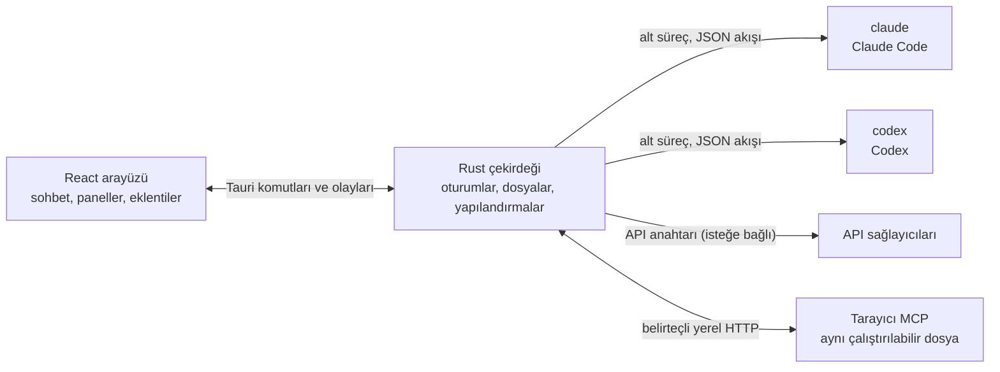

<p align="center">
  
</p>

<h1 align="center">LunaHarness</h1>

<p align="center">
  <a href="README.md">Português (Brasil)</a> · <a href="README.en.md">English</a> · <a href="README.es.md">Español</a> · <a href="README.fr.md">Français</a> · <a href="README.de.md">Deutsch</a> · <a href="README.it.md">Italiano</a> · <a href="README.nl.md">Nederlands</a> · <a href="README.pl.md">Polski</a> · <a href="README.sv.md">Svenska</a> · <a href="README.ru.md">Русский</a> · <a href="README.uk.md">Українська</a> · <strong>Türkçe</strong> · <a href="README.ar.md">العربية</a> · <a href="README.he.md">עברית</a> · <a href="README.hi.md">हिन्दी</a> · <a href="README.id.md">Bahasa Indonesia</a> · <a href="README.vi.md">Tiếng Việt</a> · <a href="README.th.md">ไทย</a> · <a href="README.ja.md">日本語</a> · <a href="README.ko.md">한국어</a> · <a href="README.zh-CN.md">简体中文</a> · <a href="README.zh-TW.md">繁體中文</a>
</p>

<p align="center">
  <strong>Claude Code</strong> ve <strong>Codex</strong> ile tek pencerede konuşmak için bir masaüstü uygulaması; eklentiler, skill'ler, MCP sunucuları ve ajanın kullanabileceği bir tarayıcı ile.
</p>

---

## Nedir

LunaHarness bir yapay zekâ modeli değildir. Zaten kullandığınız resmî CLI'lerin etrafında bir **kabuktur**: `claude` (Claude Code) ve `codex` (Codex). Uygulama bu araçları başlatır, onlarda zaten yaptığınız oturum açmayı kullanır ve sohbeti bir sohbet penceresinde gösterir; yanında ajanın yaptıklarını da gösterir: dosya değişiklikleri, plan, ilerleme ve bir terminal.

Amaç, CLI'lerin sunduklarını kaybetmeden ajanla çalışmak için tek bir yer sağlamaktır:

- Sohbeti yeniden başlatmadan sağlayıcıyı, modeli, çaba düzeyini ve izin modunu değiştirmek.
- Ajanın değişikliklerinin farkını görmek, değişiklikleri geri almak ve önceki bir noktaya dönmek.
- Skill'leri, MCP sunucularını ve eklentileri bir kez kurup iki CLI'de de kullanmak.
- Ajana sayfaları okuyabileceği ve onlarla etkileşebileceği kendi tarayıcısını vermek.

## Özellikler

**Sohbet**
- Akış (streaming), resim ve dosya ekleri ve Luna komutları, skill'ler ve CLI komutlarıyla bir `/` menüsü.
- Planlama modu: tam plan **Plan** panosuna gider, sohbet balonu yalnızca bir özet gösterir.
- Bağlam sıkıştırma: elle (`/compactar`) veya sınıra yaklaşınca otomatik.
- Genel kurallar: yazdığınız metin, iki CLI'nin `CLAUDE.md` ve `AGENTS.md` dosyalarına gider.

**Yan panel**
- **Değişiklikler:** değişen dosyaların listesi, fark ve geri alma ile.
- **Plan** ve **İlerleme:** ajanın planı ve görevin adımları, sıralı.
- **Terminal:** proje klasöründe bir kabuk (`Ctrl + `` `).
- **Tarayıcı:** ajanın da kontrol edebileceği gömülü bir sayfa (bkz. [Güncel durum](#guncel-durum)).

**Uzantılar**
- Resmî kataloglardan veya bir URL'den gelen **skill'ler** ve **MCP sunucuları**; iki CLI'nin genel yapılandırmasına kurulur.
- Sohbete davranış ekleyen **eklentiler**: kenar çubuğunda paneller, komutlar ve bildirimler. Varsayılan bir eklenti olan **Cache de Tokens**, istemin ne kadarının sağlayıcının önbelleğinden yeniden kullanıldığını gösterir.
- MCP sırları kullanıcınızın ortam değişkenlerinde kalır. Uygulama değeri asla saklamaz veya göstermez.

**Görünüm**
- Açık ve koyu tema, isteğe bağlı cam efekti ile.
- Pencere odakta değilken isteğe bağlı yanıt sesleri ve bildirimler.

## Nasıl çalışır



- Her CLI, JSON çıktısını dahili olaylara çeviren bir **adaptöre** sahiptir. Arayüz ham biçimi asla okumaz.
- Uygulama CLI kimlik bilgilerinizi saklamaz: oturum açmayı resmî ikili dosya yönetir.
- API anahtarları isteğe bağlıdır, profil bazında tanımlanır ve sistemin güvenli deposunda saklanır.

## İndirme

- Bir sürüm yayımlandığında Windows kurulum dosyası [sürümler sayfasında](https://github.com/GuilhermeFelix95/lunaCode/releases) olacak.
- Gereksinimler: Windows 10 (1809 sürümü veya üzeri) ya da Windows 11 ve en az bir kurulu ve oturum açmış CLI (`claude` veya `codex`). Node.js ve Rust gerekmez.
- Kurulum dosyasının kod imzası henüz yok, bu yüzden Windows SmartScreen uyarısı gösterebilir. "Ek bilgi" ve ardından "Yine de çalıştır" seçeneğini seçin.

## Gereksinimler

- **Windows 10 veya 11** (proje şu anda Windows için hazırlanmıştır; derleme betikleri MSVC kullanır).
- **Node.js** LTS ve **npm**.
- **Rust** (`stable` araç zinciri, `x86_64-pc-windows-msvc`) ve Visual Studio'nun C++ derleme araçları.
- En az bir CLI kurulu ve oturum açılmış olmalı: Claude Code ve/veya Codex.

## Kurulum ve çalıştırma

```bash
git clone https://github.com/GuilhermeFelix95/lunaCode.git
cd LunaHarnes
npm install
```

Uygulamayı geliştirme modunda açmak için:

```bash
npm run dev:app
```

Çalıştırılabilir dosyayı derlemek için:

```bash
npm run build:app
```

Yalnızca arayüzü tarayıcıda çalıştırmak için (Rust çekirdeği olmadan, yani CLI'ler olmadan):

```bash
npm run dev
```

## Testler

```bash
npm test                 # ön yüz (Vitest + Testing Library)
npm run test:rust        # Rust çekirdeği (cargo test)
```

Bir modülü değiştirdiğinizde o modülün testlerini çalıştırın; tam paket ise siz istediğinizde çalışır.

## Yapı

```
src/                 React + TypeScript arayüzü (sohbet, paneller, eklentiler)
src-tauri/src/       Rust çekirdeği (sağlayıcılar, oturumlar, dosyalar, MCP, eklentiler, tarayıcı)
src-tauri/marketplace/  gömülü resmî kataloglar (skill'ler, MCP, eklentiler), sha256 ile
plugins-examples/    örnek eklentiler
bin/                 `luna` komutu (skill'leri, MCP'leri ve eklentileri terminalden kurar)
docs/                kılavuzlar: stack, eklentiler, skill'ler, MCP
spec/                özellik belirtimleri (istem önbelleği, yanıt önbelleği)
```

## Dokümantasyon

- [`docs/stack.md`](docs/stack.md): yığın, mimari, proje kuralları ve değişiklikler.
- [`docs/plugins.md`](docs/plugins.md): eklenti nasıl oluşturulur (bunu Luna'nın kendisi de okur).
- [`docs/skills.md`](docs/skills.md): skill'ler nasıl çalışır.
- [`docs/mcp.md`](docs/mcp.md): MCP sunucuları ve sırların nasıl ele alındığı.
- [`docs/motor-proprio.md`](docs/motor-proprio.md): kendi motoru üzerine bir inceleme ve abonelik kullanım kuralları.
- [`spec/cache-de-prompt.md`](spec/cache-de-prompt.md): uygulamanın sağlayıcı önbelleğini nasıl ölçtüğü.

<a id="guncel-durum"></a>
## Güncel durum

Çalışıyor ve test edildi:

- Claude Code ve Codex ile sohbet, planlama, ilerleme, sıkıştırma ve fark.
- Uygulamadan veya `luna` komutuyla kurulan skill'ler, MCP sunucuları ve eklentiler.
- Her turda ölçülen istem önbelleği, Cache de Tokens eklentisiyle.
- Entegre terminal ve dal başına worktree'ler.

Geliştirme aşamasında, uygulamada uçtan uca doğrulanmadı:

- **Entegre tarayıcı:** sayfa pencerenin içinde bir webview'da görünür; Claude gezinme, okuma, tıklama ve yazma araçlarını alır. Tauri'nin `unstable` özelliğini kullanır. Codex henüz bu araçları almıyor.

## Katkıda bulunmak

`docs/` içindeki kılavuzlar proje standartlarını açıklar. Davranış değişiklikleri testlerle birlikte gelir; `docs/stack.md` ve `MEMORY.md`, kodla birlikte güncellenir.
