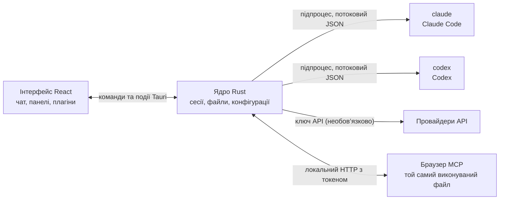

<p align="center">
  
</p>

<h1 align="center">LunaHarness</h1>

<p align="center">
  <a href="README.md">Português (Brasil)</a> · <a href="README.en.md">English</a> · <a href="README.es.md">Español</a> · <a href="README.fr.md">Français</a> · <a href="README.de.md">Deutsch</a> · <a href="README.it.md">Italiano</a> · <a href="README.nl.md">Nederlands</a> · <a href="README.pl.md">Polski</a> · <a href="README.sv.md">Svenska</a> · <a href="README.ru.md">Русский</a> · <strong>Українська</strong> · <a href="README.tr.md">Türkçe</a> · <a href="README.ar.md">العربية</a> · <a href="README.he.md">עברית</a> · <a href="README.hi.md">हिन्दी</a> · <a href="README.id.md">Bahasa Indonesia</a> · <a href="README.vi.md">Tiếng Việt</a> · <a href="README.th.md">ไทย</a> · <a href="README.ja.md">日本語</a> · <a href="README.ko.md">한국어</a> · <a href="README.zh-CN.md">简体中文</a> · <a href="README.zh-TW.md">繁體中文</a>
</p>

<p align="center">
  Настільний застосунок для роботи з <strong>Claude Code</strong> і <strong>Codex</strong> в одному вікні: з плагінами, скілами, серверами MCP і браузером, яким може користуватися агент.
</p>

---

## Що це

LunaHarness — не модель ШІ. Це **оболонка** навколо офіційних CLI, які ви вже використовуєте: `claude` (Claude Code) і `codex` (Codex). Застосунок запускає ці інструменти, використовує вхід, який ви вже виконали в них, і показує розмову у вікні чату, а поруч — що робить агент: зміни файлів, план, прогрес і термінал.

Мета — одне місце для роботи з агентом без втрати можливостей CLI:

- Зміна провайдера, моделі, рівня зусиль і режиму дозволів без перезапуску розмови.
- Перегляд diff змін агента, скасування правок і повернення до попереднього стану.
- Встановлення скілів, серверів MCP і плагінів один раз з використанням в обох CLI.
- Власний браузер для агента: читання сторінок і взаємодія з ними.

## Можливості

**Розмова**
- Чат із потоковим виведенням, вкладеннями (зображення та файли) і меню `/` з командами Луни, скілами та командами CLI.
- Режим планування: повний план потрапляє на панель **План**, а бульбашка чату показує лише короткий зміст.
- Стиснення контексту — вручну (`/compactar`) або автоматично біля ліміту.
- Глобальні правила: текст, який ви пишете, потрапляє в `CLAUDE.md` і `AGENTS.md` обох CLI.

**Бічна панель**
- **Зміни:** список змінених файлів з diff і скасуванням.
- **План** і **Прогрес:** план агента та кроки завдання за порядком.
- **Термінал:** оболонка в папці проєкту (`Ctrl + `` `).
- **Браузер:** вбудована сторінка, якою може керувати й агент (див. [Поточний стан](#поточний-стан)).

**Розширення**
- **Скіли** та **сервери MCP** з офіційних каталогів або за URL, встановлені в глобальну конфігурацію обох CLI.
- **Плагіни**, які додають до чату поведінку: панелі в бічній колонці, команди та сповіщення. Типовий плагін, **Cache de Tokens**, показує, яка частина промпта повторно використана з кешу провайдера.
- Секрети MCP лишаються в змінних середовища користувача. Застосунок ніколи не зберігає й не показує значення.

**Вигляд**
- Світла й темна теми з необов’язковим ефектом скла.
- Необов’язкові звуки відповіді та сповіщення, коли вікно не в фокусі.

## Як це працює



- Кожна CLI має **адаптер**, який перекладає її JSON-вихід у внутрішні події. Інтерфейс ніколи не читає сирий формат.
- Застосунок не зберігає ваші облікові дані CLI: вхід обробляє офіційний виконуваний файл.
- Ключі API необов’язкові, задаються для кожного профілю й зберігаються в захищеному сховищі системи.

## Вимоги

- **Windows 10 або 11** (проєкт наразі підготовлено для Windows; скрипти збірки використовують MSVC).
- **Node.js** LTS і **npm**.
- **Rust** (тулчейн `stable`, `x86_64-pc-windows-msvc`) і засоби збірки C++ з Visual Studio.
- Принаймні одна CLI встановлена й увійшла в обліковий запис: Claude Code та/або Codex.

## Встановлення та запуск

```bash
git clone https://github.com/GuilhermeFelix95/LunaHarnes.git
cd LunaHarnes
npm install
```

Щоб відкрити застосунок у режимі розробки:

```bash
npm run dev:app
```

Щоб зібрати виконуваний файл:

```bash
npm run build:app
```

Щоб запустити лише інтерфейс у браузері (без ядра Rust, тобто без CLI):

```bash
npm run dev
```

## Тести

```bash
npm test                 # фронтенд (Vitest + Testing Library)
npm run test:rust        # ядро Rust (cargo test)
```

Після зміни модуля запускайте його тести; повний набір потрібен, коли ви його запитуєте.

## Структура

```
src/                 інтерфейс React + TypeScript (чат, панелі, плагіни)
src-tauri/src/       ядро Rust (провайдери, сесії, файли, MCP, плагіни, браузер)
src-tauri/marketplace/  вбудовані офіційні каталоги (скіли, MCP, плагіни), з sha256
plugins-examples/    еталонні плагіни
bin/                 команда `luna` (встановлює скіли, MCP і плагіни з термінала)
docs/                посібники: стек, плагіни, скіли, MCP
spec/                специфікації функцій (кеш промпта, кеш відповідей)
```

## Документація

- [`docs/stack.md`](docs/stack.md): стек, архітектура, правила проєкту та зміни.
- [`docs/plugins.md`](docs/plugins.md): як створювати плагіни (цей посібник читає і сама Луна).
- [`docs/skills.md`](docs/skills.md): як працюють скіли.
- [`docs/mcp.md`](docs/mcp.md): сервери MCP і робота з секретами.
- [`docs/motor-proprio.md`](docs/motor-proprio.md): огляд власного рушія та правил використання підписок.
- [`spec/cache-de-prompt.md`](spec/cache-de-prompt.md): як застосунок вимірює кеш провайдера.

## Поточний стан

Працює і протестовано:

- Розмова з Claude Code і Codex, планування, прогрес, стиснення та diff.
- Скіли, сервери MCP і плагіни, встановлені із застосунку або командою `luna`.
- Кеш промпта, який вимірюється для кожного ходу, з плагіном Cache de Tokens.
- Вбудований термінал і worktree за гілками.

У розробці, ще не перевірено наскрізно в застосунку:

- **Вбудований браузер:** сторінка з’являється у webview всередині вікна, а Claude отримує інструменти для навігації, читання, натискання та введення. Використовується функція `unstable` Tauri. Codex ці інструменти ще не отримує.

## Участь у проєкті

Посібники в `docs/` пояснюють стандарти проєкту. Зміни поведінки йдуть із тестами, а `docs/stack.md` і `MEMORY.md` оновлюються разом із кодом.
