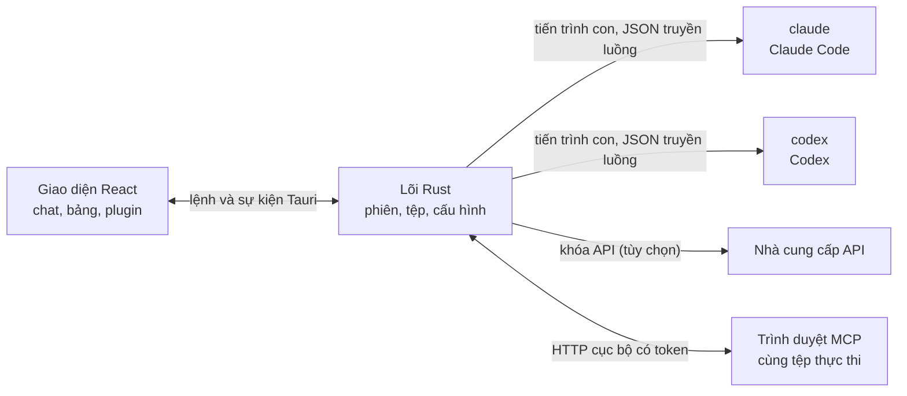

<p align="center">
  
</p>

<h1 align="center">LunaHarness</h1>

<p align="center">
  <a href="README.md">Português (Brasil)</a> · <a href="README.en.md">English</a> · <a href="README.es.md">Español</a> · <a href="README.fr.md">Français</a> · <a href="README.de.md">Deutsch</a> · <a href="README.it.md">Italiano</a> · <a href="README.nl.md">Nederlands</a> · <a href="README.pl.md">Polski</a> · <a href="README.sv.md">Svenska</a> · <a href="README.ru.md">Русский</a> · <a href="README.uk.md">Українська</a> · <a href="README.tr.md">Türkçe</a> · <a href="README.ar.md">العربية</a> · <a href="README.he.md">עברית</a> · <a href="README.hi.md">हिन्दी</a> · <a href="README.id.md">Bahasa Indonesia</a> · <strong>Tiếng Việt</strong> · <a href="README.th.md">ไทย</a> · <a href="README.ja.md">日本語</a> · <a href="README.ko.md">한국어</a> · <a href="README.zh-CN.md">简体中文</a> · <a href="README.zh-TW.md">繁體中文</a>
</p>

<p align="center">
  Ứng dụng máy tính để trò chuyện với <strong>Claude Code</strong> và <strong>Codex</strong> trong một cửa sổ, với plugin, skill, máy chủ MCP và một trình duyệt mà tác tử có thể sử dụng.
</p>

---

## Đây là gì

LunaHarness không phải là một mô hình AI. Đây là một **lớp vỏ** bao quanh các CLI chính thức mà bạn đang dùng: `claude` (Claude Code) và `codex` (Codex). Ứng dụng chạy các công cụ đó, dùng phiên đăng nhập bạn đã thực hiện trong chúng, và hiển thị cuộc trò chuyện trong cửa sổ chat, cùng với những gì tác tử đang làm: thay đổi tệp, kế hoạch, tiến độ và một terminal.

Mục tiêu là một nơi duy nhất để làm việc với tác tử, mà không mất những gì các CLI cung cấp:

- Đổi nhà cung cấp, mô hình, mức nỗ lực và chế độ quyền mà không cần khởi động lại cuộc trò chuyện.
- Xem diff các thay đổi của tác tử, hoàn tác thay đổi và quay lại một thời điểm trước đó.
- Cài đặt skill, máy chủ MCP và plugin một lần và dùng trong cả hai CLI.
- Cấp cho tác tử trình duyệt riêng để đọc trang và tương tác với chúng.

## Tính năng

**Trò chuyện**
- Chat có truyền luồng, đính kèm ảnh và tệp, và menu `/` với lệnh của Luna, skill và lệnh của CLI.
- Chế độ lập kế hoạch: toàn bộ kế hoạch chuyển đến bảng **Kế hoạch**, còn bong bóng chat chỉ hiển thị tóm tắt.
- Nén ngữ cảnh, thủ công (`/compactar`) hoặc tự động khi gần giới hạn.
- Quy tắc chung: văn bản bạn viết sẽ đi vào `CLAUDE.md` và `AGENTS.md` của cả hai CLI.

**Thanh bên**
- **Thay đổi:** danh sách tệp đã sửa, kèm diff và hoàn tác.
- **Kế hoạch** và **Tiến độ:** kế hoạch của tác tử và các bước của tác vụ, theo thứ tự.
- **Terminal:** một shell trong thư mục dự án (`Ctrl + `` `).
- **Trình duyệt:** một trang nhúng mà tác tử cũng có thể điều khiển (xem [Trạng thái hiện tại](#trang-thai-hien-tai)).

**Tiện ích mở rộng**
- **Skill** và **máy chủ MCP** từ danh mục chính thức hoặc qua URL, được cài vào cấu hình chung của cả hai CLI.
- **Plugin** thêm hành vi vào chat: bảng trên thanh bên, lệnh và thông báo. Một plugin mặc định, **Cache de Tokens**, cho biết bao nhiêu phần của prompt được tái sử dụng từ bộ nhớ đệm của nhà cung cấp.
- Bí mật của MCP được giữ trong biến môi trường của người dùng. Ứng dụng không bao giờ lưu hay hiển thị giá trị.

**Giao diện**
- Chủ đề sáng và tối, có hiệu ứng kính tùy chọn.
- Âm thanh phản hồi và thông báo tùy chọn khi cửa sổ không được focus.

## Hoạt động như thế nào



- Mỗi CLI có một **bộ chuyển đổi** dịch đầu ra JSON của nó thành sự kiện nội bộ. Giao diện không bao giờ đọc định dạng thô.
- Ứng dụng không giữ thông tin đăng nhập CLI của bạn: tệp nhị phân chính thức tự xử lý việc đăng nhập.
- Khóa API là tùy chọn, theo từng hồ sơ, và được lưu trong kho an toàn của hệ thống.

## Tải về

- Khi có phiên bản được phát hành, trình cài đặt cho Windows sẽ nằm ở [trang phát hành](https://github.com/GuilhermeFelix95/lunaCode/releases).
- Yêu cầu: Windows 10 (phiên bản 1809 trở lên) hoặc Windows 11, và ít nhất một CLI đã cài đặt và đăng nhập (`claude` hoặc `codex`). Không cần Node.js hay Rust.
- Trình cài đặt chưa có chữ ký mã, nên Windows có thể hiện cảnh báo SmartScreen. Chọn "More info" rồi "Run anyway".

## Yêu cầu

- **Windows 10 hoặc 11** (dự án hiện được chuẩn bị cho Windows; các script build dùng MSVC).
- **Node.js** LTS và **npm**.
- **Rust** (toolchain `stable`, `x86_64-pc-windows-msvc`) và các công cụ build C++ của Visual Studio.
- Ít nhất một CLI đã cài đặt và đã đăng nhập: Claude Code và/hoặc Codex.

## Cài đặt và chạy

```bash
git clone https://github.com/GuilhermeFelix95/lunaCode.git
cd LunaHarnes
npm install
```

Để mở ứng dụng ở chế độ phát triển:

```bash
npm run dev:app
```

Để build tệp thực thi:

```bash
npm run build:app
```

Để chỉ chạy giao diện trên trình duyệt (không có lõi Rust, tức là không có CLI):

```bash
npm run dev
```

## Kiểm thử

```bash
npm test                 # frontend (Vitest + Testing Library)
npm run test:rust        # lõi Rust (cargo test)
```

Khi thay đổi một module, hãy chạy kiểm thử của module đó; bộ kiểm thử đầy đủ được chạy khi bạn yêu cầu.

## Cấu trúc

```
src/                 giao diện React + TypeScript (chat, bảng, plugin)
src-tauri/src/       lõi Rust (nhà cung cấp, phiên, tệp, MCP, plugin, trình duyệt)
src-tauri/marketplace/  danh mục chính thức đi kèm (skill, MCP, plugin), có sha256
plugins-examples/    plugin tham khảo
bin/                 lệnh `luna` (cài skill, MCP và plugin từ terminal)
docs/                hướng dẫn: stack, plugin, skill, MCP
spec/                đặc tả tính năng (bộ nhớ đệm prompt, bộ nhớ đệm phản hồi)
```

## Tài liệu

- [`docs/stack.md`](docs/stack.md): stack, kiến trúc, quy tắc dự án và thay đổi.
- [`docs/plugins.md`](docs/plugins.md): cách tạo plugin (chính Luna cũng đọc tài liệu này).
- [`docs/skills.md`](docs/skills.md): cách skill hoạt động.
- [`docs/mcp.md`](docs/mcp.md): máy chủ MCP và cách xử lý bí mật.
- [`docs/motor-proprio.md`](docs/motor-proprio.md): nghiên cứu về một động cơ riêng và quy tắc sử dụng gói đăng ký.
- [`spec/cache-de-prompt.md`](spec/cache-de-prompt.md): cách ứng dụng đo bộ nhớ đệm của nhà cung cấp.

<a id="trang-thai-hien-tai"></a>
## Trạng thái hiện tại

Hoạt động và đã được kiểm thử:

- Trò chuyện với Claude Code và Codex, lập kế hoạch, tiến độ, nén ngữ cảnh và diff.
- Skill, máy chủ MCP và plugin được cài từ ứng dụng hoặc lệnh `luna`.
- Bộ nhớ đệm prompt được đo cho mỗi lượt, với plugin Cache de Tokens.
- Terminal tích hợp và worktree theo nhánh.

Đang phát triển, chưa được kiểm chứng đầu cuối trong ứng dụng:

- **Trình duyệt tích hợp:** trang xuất hiện trong một webview bên trong cửa sổ, và Claude nhận các công cụ điều hướng, đọc, nhấp và nhập. Nó dùng tính năng `unstable` của Tauri. Codex chưa nhận các công cụ này.

## Đóng góp

Các hướng dẫn trong `docs/` giải thích tiêu chuẩn của dự án. Thay đổi hành vi đi kèm kiểm thử, và `docs/stack.md` cùng `MEMORY.md` được cập nhật cùng với mã nguồn.
