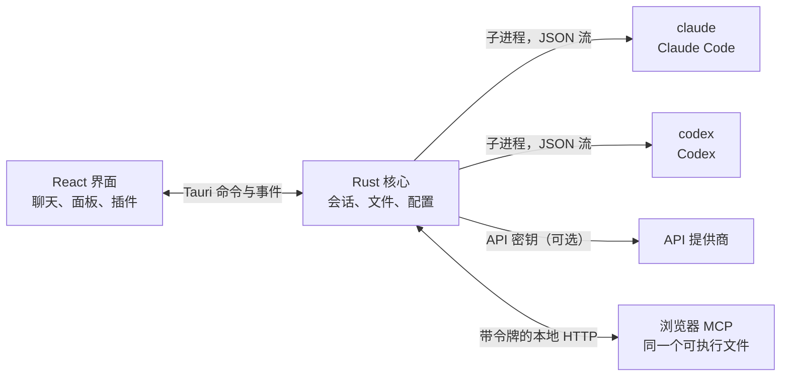

<p align="center">
  
</p>

<h1 align="center">LunaHarness</h1>

<p align="center">
  <a href="README.md">Português (Brasil)</a> · <a href="README.en.md">English</a> · <a href="README.es.md">Español</a> · <a href="README.fr.md">Français</a> · <a href="README.de.md">Deutsch</a> · <a href="README.it.md">Italiano</a> · <a href="README.nl.md">Nederlands</a> · <a href="README.pl.md">Polski</a> · <a href="README.sv.md">Svenska</a> · <a href="README.ru.md">Русский</a> · <a href="README.uk.md">Українська</a> · <a href="README.tr.md">Türkçe</a> · <a href="README.ar.md">العربية</a> · <a href="README.he.md">עברית</a> · <a href="README.hi.md">हिन्दी</a> · <a href="README.id.md">Bahasa Indonesia</a> · <a href="README.vi.md">Tiếng Việt</a> · <a href="README.th.md">ไทย</a> · <a href="README.ja.md">日本語</a> · <a href="README.ko.md">한국어</a> · <strong>简体中文</strong> · <a href="README.zh-TW.md">繁體中文</a>
</p>

<p align="center">
  一款桌面应用，让你在同一个窗口里与 <strong>Claude Code</strong> 和 <strong>Codex</strong> 对话，并提供插件、Skills、MCP 服务器，以及智能体可以使用的浏览器。
</p>

---

## 这是什么

LunaHarness 不是 AI 模型。它是包裹在你已在使用的官方 CLI 外面的一层**外壳**：`claude`（Claude Code）和 `codex`（Codex）。应用会启动这些工具，沿用你在其中已经完成的登录，并在聊天窗口中显示对话；旁边还会显示智能体正在做的事情：文件改动、计划、进度和终端。

目标是在不失去 CLI 功能的前提下，把与智能体的协作集中到一个地方：

- 无需重新开始对话，即可切换提供商、模型、努力程度和权限模式。
- 查看智能体所做改动的 diff，撤销改动，并回到之前的某个时间点。
- 只需安装一次 Skills、MCP 服务器和插件，两个 CLI 都能使用。
- 为智能体提供自己的浏览器，让它读取网页并与之交互。

## 功能

**对话**
- 支持流式输出的聊天、图片和文件附件，以及一个 `/` 菜单，里面有 Luna 命令、Skills 和 CLI 命令。
- 计划模式：完整计划显示在 **计划** 面板中，聊天气泡只显示摘要。
- 上下文压缩，可以手动执行（`/compactar`），也可以在接近上限时自动执行。
- 全局规则：你输入的文本会写入两个 CLI 的 `CLAUDE.md` 和 `AGENTS.md`。

**侧边面板**
- **更改：** 已修改文件的列表，支持 diff 和撤销。
- **计划** 和 **进度：** 智能体的计划和任务步骤，按顺序显示。
- **终端：** 在项目文件夹中运行的 shell（`Ctrl + `` `）。
- **浏览器：** 内嵌页面，智能体也可以控制（参见[当前状态](#当前状态)）。

**扩展**
- 来自官方目录或 URL 的 **Skills** 和 **MCP 服务器**，安装到两个 CLI 的全局配置中。
- 为聊天添加功能的**插件**：侧边栏面板、命令和通知。默认插件 **Cache de Tokens** 会显示提示中有多少部分复用了提供商缓存。
- MCP 的敏感信息保存在你用户的环境变量中。应用从不保存或显示其值。

**外观**
- 浅色和深色主题，可选毛玻璃效果。
- 窗口未获得焦点时，可选择播放回复提示音并发送通知。

## 工作原理



- 每个 CLI 都有一个**适配器**，负责把它的 JSON 输出转换为内部事件。界面从不直接读取原始格式。
- 应用不保存你的 CLI 凭据：登录由官方可执行文件处理。
- API 密钥是可选的，按配置文件设置，并保存在系统的安全存储中。

## 运行要求

- **Windows 10 或 11**（项目目前面向 Windows；构建脚本使用 MSVC）。
- **Node.js** LTS 和 **npm**。
- **Rust**（`stable` 工具链，`x86_64-pc-windows-msvc`）以及 Visual Studio 的 C++ 构建工具。
- 至少安装并登录一个 CLI：Claude Code 和/或 Codex。

## 安装与运行

```bash
git clone https://github.com/GuilhermeFelix95/LunaHarnes.git
cd LunaHarnes
npm install
```

以开发模式打开应用：

```bash
npm run dev:app
```

构建可执行文件：

```bash
npm run build:app
```

只在浏览器中运行界面（没有 Rust 核心，因此不能使用 CLI）：

```bash
npm run dev
```

## 测试

```bash
npm test                 # 前端（Vitest + Testing Library）
npm run test:rust        # Rust 核心（cargo test）
```

修改某个模块后，运行该模块的测试即可；完整测试套件在你请求时再运行。

## 结构

```
src/                 React + TypeScript 界面（聊天、面板、插件）
src-tauri/src/       Rust 核心（提供商、会话、文件、MCP、插件、浏览器）
src-tauri/marketplace/  内置的官方目录（Skills、MCP、插件），附带 sha256
plugins-examples/    参考插件
bin/                 `luna` 命令（在终端中安装 Skills、MCP 和插件）
docs/                指南：stack、插件、Skills、MCP
spec/                功能规格（提示缓存、响应缓存）
```

## 文档

- [`docs/stack.md`](docs/stack.md)：技术栈、架构、项目规则和变更记录。
- [`docs/plugins.md`](docs/plugins.md)：如何创建插件（Luna 本身也会读取这份文档）。
- [`docs/skills.md`](docs/skills.md)：Skills 的工作方式。
- [`docs/mcp.md`](docs/mcp.md)：MCP 服务器及敏感信息的处理方式。
- [`docs/motor-proprio.md`](docs/motor-proprio.md)：关于自有引擎的研究，以及订阅的使用规则。
- [`spec/cache-de-prompt.md`](spec/cache-de-prompt.md)：应用如何测量提供商缓存。

<a id="当前状态"></a>
## 当前状态

已可运行并经过测试：

- 与 Claude Code 和 Codex 对话、计划、进度、压缩和 diff。
- 通过应用或 `luna` 命令安装的 Skills、MCP 服务器和插件。
- 按轮次测量的提示缓存，配合 Cache de Tokens 插件。
- 集成终端，以及按分支划分的 worktree。

开发中，尚未在应用里完成端到端验证：

- **集成浏览器：** 页面会显示在窗口内的 webview 中，Claude 会获得导航、读取、点击和输入的工具。它使用 Tauri 的 `unstable` 功能。Codex 目前还不能使用这些工具。

## 贡献

`docs/` 中的指南说明了项目的标准。行为变更需要附带测试，`docs/stack.md` 和 `MEMORY.md` 与代码一同更新。
