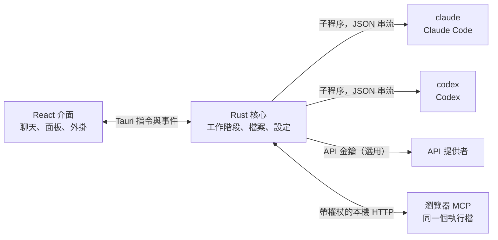

<p align="center">
  
</p>

<h1 align="center">LunaHarness</h1>

<p align="center">
  <a href="README.md">Português (Brasil)</a> · <a href="README.en.md">English</a> · <a href="README.es.md">Español</a> · <a href="README.fr.md">Français</a> · <a href="README.de.md">Deutsch</a> · <a href="README.it.md">Italiano</a> · <a href="README.nl.md">Nederlands</a> · <a href="README.pl.md">Polski</a> · <a href="README.sv.md">Svenska</a> · <a href="README.ru.md">Русский</a> · <a href="README.uk.md">Українська</a> · <a href="README.tr.md">Türkçe</a> · <a href="README.ar.md">العربية</a> · <a href="README.he.md">עברית</a> · <a href="README.hi.md">हिन्दी</a> · <a href="README.id.md">Bahasa Indonesia</a> · <a href="README.vi.md">Tiếng Việt</a> · <a href="README.th.md">ไทย</a> · <a href="README.ja.md">日本語</a> · <a href="README.ko.md">한국어</a> · <a href="README.zh-CN.md">简体中文</a> · <strong>繁體中文</strong>
</p>

<p align="center">
  一款桌面應用程式，讓你在同一個視窗裡與 <strong>Claude Code</strong> 和 <strong>Codex</strong> 對話，並提供外掛、Skills、MCP 伺服器，以及代理可以使用的瀏覽器。
</p>

---

## 這是什麼

LunaHarness 不是 AI 模型。它是包裹在你已經在使用的官方 CLI 外面的一層**外殼**：`claude`（Claude Code）和 `codex`（Codex）。應用程式會啟動這些工具，沿用你在其中已完成的登入，並在聊天視窗中顯示對話；旁邊還會顯示代理正在做的事：檔案變更、計畫、進度和終端機。

目標是在不失去 CLI 功能的前提下，把與代理的協作集中到一個地方：

- 無需重新開始對話，即可切換提供者、模型、努力程度和權限模式。
- 查看代理所做變更的 diff，撤銷變更，並回到之前的某個時間點。
- 只需安裝一次 Skills、MCP 伺服器和外掛，兩個 CLI 都能使用。
- 為代理提供自己的瀏覽器，讓它讀取網頁並與之互動。

## 功能

**對話**
- 支援串流輸出的聊天、圖片和檔案附件，以及一個 `/` 選單，裡面有 Luna 指令、Skills 和 CLI 指令。
- 計畫模式：完整計畫顯示在 **計畫** 面板中，聊天泡泡只顯示摘要。
- 內容壓縮，可以手動執行（`/compactar`），也可以在接近上限時自動執行。
- 全域規則：你輸入的文字會寫入兩個 CLI 的 `CLAUDE.md` 和 `AGENTS.md`。

**側邊面板**
- **變更：** 已修改檔案的清單，支援 diff 和撤銷。
- **計畫** 和 **進度：** 代理的計畫和任務步驟，依順序顯示。
- **終端機：** 在專案資料夾中執行的 shell（`Ctrl + `` `）。
- **瀏覽器：** 內嵌頁面，代理也可以操作（參見[目前狀態](#目前狀態)）。

**擴充功能**
- 來自官方目錄或 URL 的 **Skills** 和 **MCP 伺服器**，安裝到兩個 CLI 的全域設定中。
- 為聊天加入功能的**外掛**：側邊欄面板、指令和通知。預設外掛 **Cache de Tokens** 會顯示提示中有多少部分重複使用了提供者的快取。
- MCP 的敏感資訊保存在你使用者的環境變數中。應用程式從不儲存或顯示其值。

**外觀**
- 淺色和深色主題，可選毛玻璃效果。
- 視窗未取得焦點時，可選擇播放回覆提示音並發送通知。

## 運作方式



- 每個 CLI 都有一個**轉接器**，負責把它的 JSON 輸出轉換為內部事件。介面從不直接讀取原始格式。
- 應用程式不保存你的 CLI 憑證：登入由官方執行檔處理。
- API 金鑰是選用的，依設定檔設定，並保存在系統的安全儲存空間中。

## 執行需求

- **Windows 10 或 11**（專案目前面向 Windows；建置指令碼使用 MSVC）。
- **Node.js** LTS 和 **npm**。
- **Rust**（`stable` 工具鏈，`x86_64-pc-windows-msvc`）以及 Visual Studio 的 C++ 建置工具。
- 至少安裝並登入一個 CLI：Claude Code 和/或 Codex。

## 安裝與執行

```bash
git clone https://github.com/GuilhermeFelix95/LunaHarnes.git
cd LunaHarnes
npm install
```

以開發模式開啟應用程式：

```bash
npm run dev:app
```

建置執行檔：

```bash
npm run build:app
```

只在瀏覽器中執行介面（沒有 Rust 核心，因此無法使用 CLI）：

```bash
npm run dev
```

## 測試

```bash
npm test                 # 前端（Vitest + Testing Library）
npm run test:rust        # Rust 核心（cargo test）
```

修改某個模組後，執行該模組的測試即可；完整測試套件在你要求時再執行。

## 結構

```
src/                 React + TypeScript 介面（聊天、面板、外掛）
src-tauri/src/       Rust 核心（提供者、工作階段、檔案、MCP、外掛、瀏覽器）
src-tauri/marketplace/  內建的官方目錄（Skills、MCP、外掛），附帶 sha256
plugins-examples/    參考外掛
bin/                 `luna` 指令（在終端機中安裝 Skills、MCP 和外掛）
docs/                指南：stack、外掛、Skills、MCP
spec/                功能規格（提示快取、回應快取）
```

## 文件

- [`docs/stack.md`](docs/stack.md)：技術堆疊、架構、專案規則和變更紀錄。
- [`docs/plugins.md`](docs/plugins.md)：如何建立外掛（Luna 本身也會讀取這份文件）。
- [`docs/skills.md`](docs/skills.md)：Skills 的運作方式。
- [`docs/mcp.md`](docs/mcp.md)：MCP 伺服器及敏感資訊的處理方式。
- [`docs/motor-proprio.md`](docs/motor-proprio.md)：關於自有引擎的研究，以及訂閱的使用規則。
- [`spec/cache-de-prompt.md`](spec/cache-de-prompt.md)：應用程式如何測量提供者快取。

<a id="目前狀態"></a>
## 目前狀態

已可運作並經過測試：

- 與 Claude Code 和 Codex 對話、計畫、進度、壓縮和 diff。
- 透過應用程式或 `luna` 指令安裝的 Skills、MCP 伺服器和外掛。
- 依回合測量的提示快取，搭配 Cache de Tokens 外掛。
- 整合終端機，以及依分支劃分的 worktree。

開發中，尚未在應用程式中完成端對端驗證：

- **整合瀏覽器：** 頁面會顯示在視窗內的 webview 中，Claude 會取得導覽、讀取、點擊和輸入的工具。它使用 Tauri 的 `unstable` 功能。Codex 目前還不能使用這些工具。

## 貢獻

`docs/` 中的指南說明了專案的標準。行為變更需要附帶測試，`docs/stack.md` 和 `MEMORY.md` 會與程式碼一同更新。
